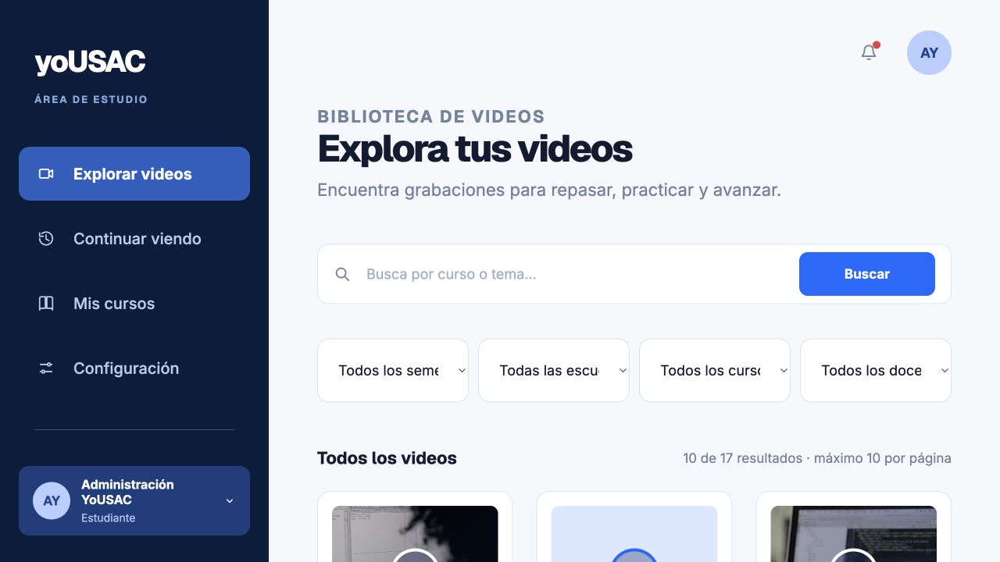

# YoUSAC — microservices platform for recorded classes

A web app where engineering students at Universidad de San Carlos de Guatemala browse, play and rate recorded classes. Players resume from a saved checkpoint. Admins manage the catalog, roles and course assignments, and see viewing analytics.

Course project for *Software Avanzado* (2nd semester 2026). I built it alone: design documents, five services, gateway, frontend and cloud deployment.



## Architecture

```text
Browser ─► Next.js frontend ─► NestJS API Gateway (HTTPS, JWT cookie) ─► gRPC over HTTP/2
                                                                           ├─ Identity        TypeScript · PostgreSQL
                                                                           ├─ Catalog         TypeScript · PostgreSQL
                                                                           ├─ Playback        Go         · MongoDB + video storage
                                                                           ├─ Analytics       Python     · MongoDB + Redis
                                                                           └─ Notifications   TypeScript · PostgreSQL + Mailpit
```

- **One database per service.** No service reads another's database. Analytics asks Catalog, Identity and Playback over gRPC.
- **Contracts first.** Every service has a `.proto` in [`proto/`](proto/), and `npm run test:contracts` checks the gateway against them.
- **The gateway is the only public entry point.** It handles the session (`HttpOnly`, `Secure`, `SameSite=Strict` cookie), Google OAuth limited to university email domains, gRPC timeouts, and the translation of gRPC errors to HTTP (`UNAUTHENTICATED` → 401, `PERMISSION_DENIED` → 403, `DEADLINE_EXCEEDED` → 504…).
- **Internal calls forward the JWT,** and each service validates it again.
- **RBAC, bulk CSV catalog upload, database-side pagination,** and transactions in PostgreSQL stored procedures.
- **Video streaming** with resumable checkpoints, from local disk or Google Cloud Storage.
- **Analytics:** most viewed, trending topics by exam period, top rated, and recommendations, cached in Redis.

## Stack

NestJS · Next.js · Go · Python · gRPC / Protocol Buffers · PostgreSQL · MongoDB · Redis · Docker Compose · Google Cloud (Compute Engine, Cloud Storage) · TLS

## Run it locally

```sh
cp .env.example .env          # fill in the placeholders
npm install
npm run verify                # format, lint, typecheck, tests (TS, Go, Python) and contract check
docker compose --env-file .env -f docker-compose.local.yml up -d --build
```

Full guide: [implementation v0.2.0](docs/implementacion-v0.2.0.md). Cloud deployment (Compute Engine VM, a service account with read-only bucket access, no JSON keys on the VM): [despliegue-gcp.md](docs/despliegue-gcp.md).

## Design documents (Spanish)

- [Functional](docs/requerimientos/funcionales.md) and [non-functional](docs/requerimientos/no-funcionales.md) requirements
- [Use case model](docs/casos-de-uso/modelo-casos-de-uso.md)
- [4+1 architecture model](docs/arquitectura/modelo-4-1.md), with diagrams in [`docs/arquitectura/img`](docs/arquitectura/img)
- [Entity-relationship model](docs/base-de-datos/modelo-entidad-relacion.md)
- [UI mockups](docs/mockups/README.md)
- Reports: [Práctica 1](docs/practica-1.md), [Práctica 3](docs/practica-3.md), [Fase 1](docs/fase-1.md)
