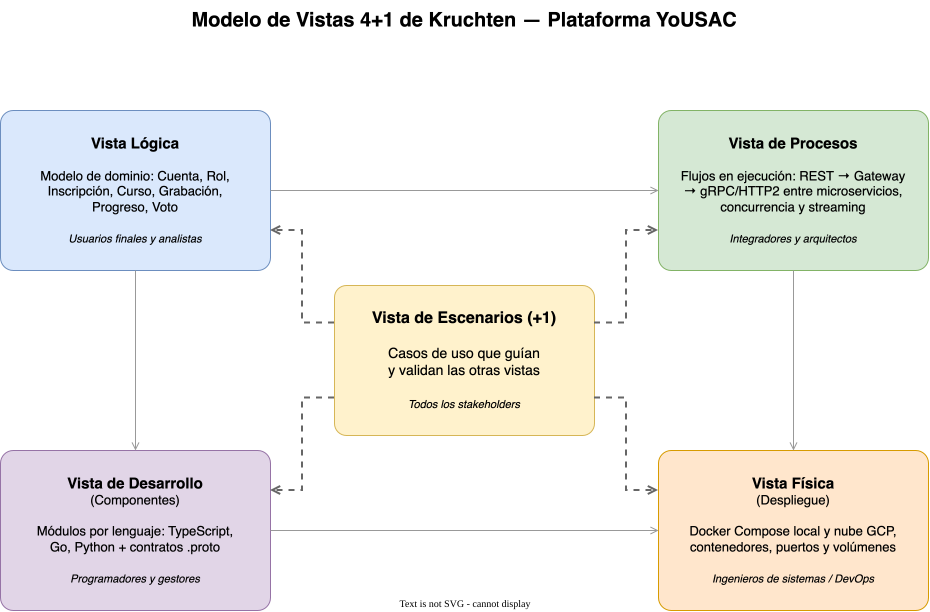
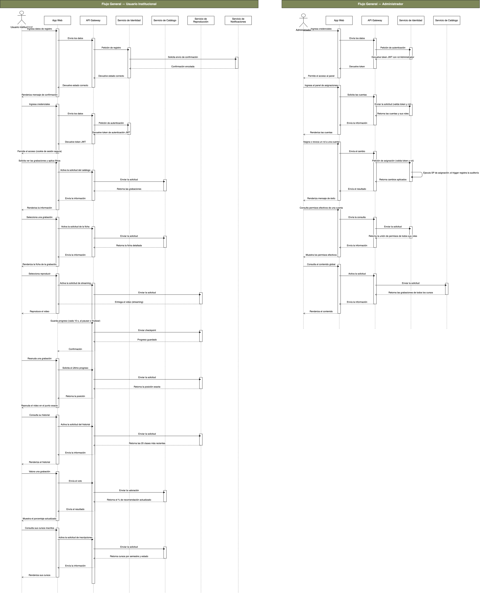
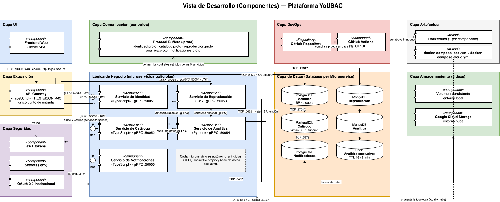
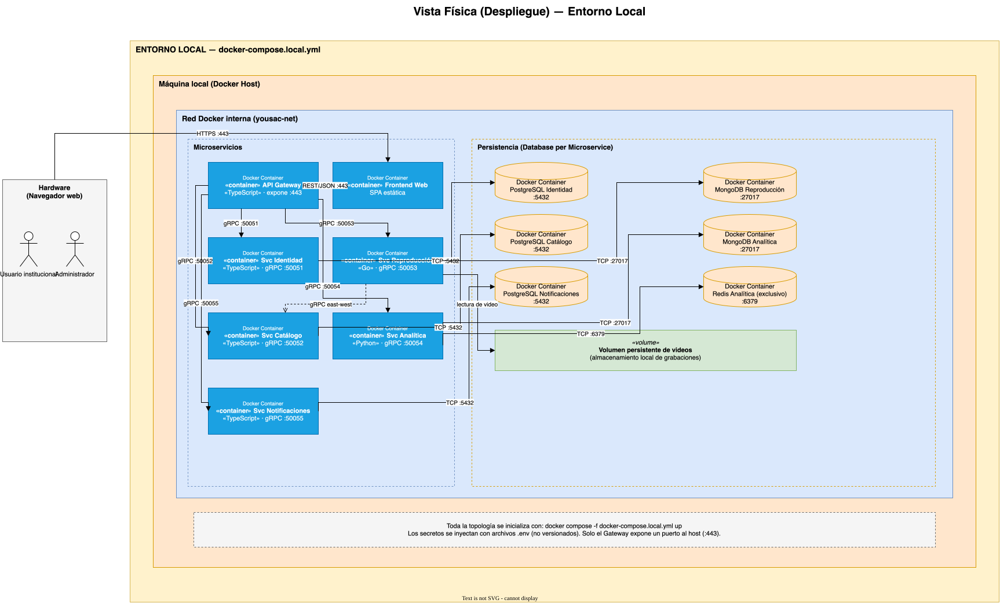

# Modelo de Vistas 4+1 — Plataforma YoUSAC

## Índice

- [Modelo de Vistas 4+1](#modelo-de-vistas-41)
- [1. Vista Lógica](#1-vista-lógica)
- [2. Vista de Procesos](#2-vista-de-procesos)
- [3. Vista de Componentes (Vista de Desarrollo)](#3-vista-de-componentes-vista-de-desarrollo)
- [4. Vista Física (Vista de Despliegue)](#4-vista-física-vista-de-despliegue)
- [5. Vista de Escenarios — La vista "+1"](#5-vista-de-escenarios--la-vista-1)

---

El modelo de vistas 4+1 es una metodología de diseño de arquitectura de software, propuesta por Philippe Kruchten, que permite describir y comprender la arquitectura de un sistema de forma integral. Dado que un sistema de software es complejo y debe satisfacer los intereses de diversos actores como usuarios finales, desarrolladores, integradores y administradores de sistemas, este modelo utiliza perspectivas separadas pero complementarias, permitiendo abstraer detalles innecesarios en cada contexto.

Las vistas contempladas son: Lógica, Procesos, Desarrollo (Componentes), Física (Despliegue) y la vista de Escenarios, que actúa como el hilo conductor que valida todas las demás. En el caso de YoUSAC, las cinco vistas detallan explícitamente la **matriz políglota** (TypeScript, Go y Python) y la **comunicación interna vía gRPC sobre HTTP/2** con contratos Protocol Buffers.

---

## 1. Vista Lógica

La vista lógica está orientada principalmente a los **usuarios finales** y analistas del sistema. Se encarga de capturar y modelar cómo el sistema satisface los requerimientos funcionales, es decir, lo que el sistema debe hacer. En esta vista se muestran los flujos generales de los actores a través de los objetos y servicios del dominio, sin preocuparse por los detalles técnicos de bajo nivel o el despliegue físico.

En este caso se desarrollaron dos flujos generales. El flujo del **Usuario institucional** cubre los objetivos centrales de la Práctica 1: registrarse con correo de la Facultad de Ingeniería, iniciar sesión, explorar y filtrar el catálogo, consultar la ficha de una grabación, reproducir con *checkpoint* de avance cada 10 segundos, reanudar en la posición exacta, consultar el historial (20 clases más recientes), valorar una grabación y consultar sus cursos inscritos. El flujo del **Administrador** cubre la gestión de roles y permisos (RBAC), la consulta de permisos efectivos — calculados como la unión de los permisos de todos los roles de la cuenta — y el acceso global al contenido.

> **Nota:** las entidades de cada dominio se relacionan entre microservicios únicamente mediante referencias lógicas por ID, sin llaves foráneas físicas, respetando el patrón *Database per Microservice*. El detalle de entidades, atributos y relaciones se documenta en el [modelo Entidad-Relación](../base-de-datos/modelo-entidad-relacion.md).

---

## 2. Vista de Procesos

La vista de procesos está dirigida a los **integradores de sistemas** y arquitectos. Esta vista enfatiza el comportamiento dinámico del sistema en tiempo de ejecución: concurrencia, distribución, rendimiento y escalabilidad. Aquí se detalla cómo los elementos de la vista lógica se mapean a procesos de ejecución y cómo fluye la comunicación entre componentes que operan simultáneamente.

Se modelaron los tres procesos más exigentes de la plataforma:

1. **Autenticación y sesión segura:** el cliente solo habla REST/JSON con el API Gateway (tráfico *north-south*); el Gateway invoca al Servicio de Identidad mediante gRPC/HTTP2 (tráfico *east-west*). La verificación de contraseña usa hash con sal y costo configurable, los permisos efectivos se calculan como la unión de roles y la sesión se entrega como JWT + cookie `HttpOnly`/`Secure` con expiración de 60 minutos por inactividad. Se incluye la variante con OAuth 2.0 institucional.
2. **Streaming y checkpoint de avance:** el Servicio de Reproducción (Go) valida la grabación contra el Servicio de Catálogo vía gRPC, abre el video desde el almacén (volumen local o GCS) y entrega el *stream*. El progreso se ingesta cada 10 segundos y al pausar o finalizar, con escritura *upsert* en MongoDB, soportando al menos 500 usuarios concurrentes.
3. **Valoración y % de recomendación:** el voto binario único y modificable se registra en PostgreSQL y el porcentaje se calcula con una **función almacenada** (`votos positivos ÷ total de votos`), devolviendo el valor actualizado en la misma operación.

En todos los casos se respeta la restricción de que **ningún microservicio expone REST**; la comunicación interna es exclusivamente gRPC con contratos Protocol Buffers y JWT *service-to-service*.

---

## 3. Vista de Componentes (Vista de Desarrollo)

### Introducción

La vista de desarrollo o componentes presenta el sistema YoUSAC desde la perspectiva de los **programadores y gestores de software**. Su objetivo es mostrar cómo se organizan los módulos de software en el entorno de desarrollo, cómo se separan las responsabilidades por capas y de qué forma se comunican los componentes físicos de código.

### Organización en capas

- **Capa UI:** Frontend Web (cliente SPA). Es la única pieza que corre del lado del usuario.
- **Capa Exposición:** API Gateway, único punto de entrada REST/JSON (`:443`). Ningún cliente externo comunica directamente con los microservicios.
- **Capa Comunicación (contratos):** archivos `.proto` (Protocol Buffers) que definen los contratos estrictos de los cinco servicios.
- **Lógica de Negocio:** los cinco microservicios políglotas con sus interfaces gRPC (`IIdentidad`, `ICatalogo`, `IReproduccion`, `IAnalitica`, `INotificaciones`).
- **Capa de Datos:** una base de datos por microservicio (*Database per Microservice*).
- **Capa Almacenamiento:** volumen persistente (local) o Google Cloud Storage (nube) para los videos.
- **Capa Seguridad:** JWT, secretos `.env` y OAuth 2.0 institucional.
- **Capa DevOps y Artefactos:** GitHub Repository + GitHub Actions (CI/CD), un Dockerfile por componente y los dos archivos Docker Compose.

### Componentes principales del sistema

1. Frontend Web (SPA)
2. API Gateway — TypeScript
3. Servicio de Identidad — TypeScript
4. Servicio de Catálogo — TypeScript
5. Servicio de Reproducción — Go
6. Servicio de Analítica — Python
7. Servicio de Notificaciones — TypeScript
8. Contratos Protocol Buffers (`.proto`)
9. 3× PostgreSQL, 2× MongoDB, 1× Redis (exclusivo de Analítica)
10. Almacén de videos (volumen local / GCS)

### Comunicación entre componentes

- **Externa (north-south):** REST/JSON sobre `:443` entre el cliente y el API Gateway, con cookie de sesión `HttpOnly` + `Secure`.
- **Interna (east-west):** exclusivamente gRPC sobre HTTP/2 con mensajes Protocol Buffers y JWT entre servicios (`:50051`–`:50055`). Está prohibido REST entre microservicios.
- **Persistencia:** cada servicio accede únicamente a su propia base de datos (PostgreSQL `:5432`, MongoDB `:27017`, Redis `:6379`).
- **Lógica programable en BD:** procedimientos almacenados (asignaciones), vistas (catálogo y fichas), función almacenada (% de recomendación) y triggers (auditoría de credenciales y roles).

### Matriz políglota y tecnologías utilizadas

| Categoría | Tecnología |
|---|---|
| Frontend | SPA (cliente web estático) |
| Gateway | TypeScript · REST/JSON :443 |
| Identidad, Catálogo, Notificaciones | TypeScript · gRPC |
| Reproducción | Go · gRPC |
| Analítica | Python · gRPC · Redis |
| Contratos internos | Protocol Buffers (.proto) sobre gRPC/HTTP2 |
| Bases de datos | PostgreSQL ×3, MongoDB ×2 (Database per Microservice) |
| Caché | Redis (TTL 15 min catálogo · 5 min tendencias) |
| Seguridad | JWT, Session Cookies (HttpOnly/Secure), OAuth 2.0 |
| Almacenamiento de videos | Volumen persistente (local) · Google Cloud Storage (nube) |
| Contenedores | Docker + Docker Compose (local y nube) |
| CI/CD | GitHub + GitHub Actions |

### Explicación del diagrama de componentes

El Frontend Web canaliza todas las solicitudes hacia el API Gateway. Este valida la sesión y distribuye las peticiones a los microservicios mediante sus interfaces gRPC, definidas por los contratos `.proto` compartidos. Cada servicio mantiene persistencia exclusiva, lo que garantiza autonomía y aislamiento de fallos. El Servicio de Reproducción consulta a Catálogo (`ObtenerGrabacion`) y Analítica consume datos de Catálogo y Reproducción, siempre por gRPC. Los artefactos de despliegue (Dockerfiles y los dos Docker Compose) permiten reconstruir la topología completa en local o en la nube sin cambios de código.

---

## 4. Vista Física (Vista de Despliegue)

### Introducción

La vista física o de despliegue se dirige a los **ingenieros de sistemas y operaciones (DevOps)**. Describe topológicamente cómo se distribuyen los componentes de software sobre la infraestructura de ejecución, identificando nodos de red, contenedores, puertos y servicios externos. Se documentan los dos entornos obligatorios: **local** y **nube (GCP)**.

### Nodos del sistema (entorno local)

1. **Nodo Cliente:** actores físicos (Usuario institucional y Administrador) interactuando desde un navegador web (`HTTPS :443`).
2. **Máquina local (Docker Host):** ejecuta toda la topología con `docker-compose.local.yml`.
3. **Red Docker interna (`yousac-net`):** contiene los contenedores de microservicios (Frontend, API Gateway y los cinco servicios políglotas) y los contenedores de persistencia.
4. **Persistencia:** 3× PostgreSQL (`:5432`), 2× MongoDB (`:27017`) y Redis (`:6379`), cada uno en su propio contenedor.
5. **Volumen persistente de videos:** almacenamiento local de las grabaciones.

### Nodos del sistema (entorno nube)

1. **Nodo Cliente:** navegador web (`HTTPS :443`).
2. **Google Cloud Platform:** entorno de ejecución en la nube pública obligatoria.
3. **Compute Engine (VM):** Docker Host que ejecuta `docker-compose.cloud.yml` con políticas de reinicio; aloja los mismos contenedores que el entorno local.
4. **Google Cloud Storage:** *bucket* que almacena las grabaciones; el Servicio de Reproducción lo consume vía `HTTPS :443` (API de GCS).
5. **GitHub Actions (CI/CD):** compila, prueba y despliega automáticamente los cambios aprobados sobre la VM.

### Explicación de los diagramas de despliegue

En ambos entornos el tráfico web entra únicamente por el API Gateway (`:443`); los demás puertos permanecen dentro de la red Docker interna. Una vez en el Gateway, el flujo se bifurca hacia el microservicio correspondiente vía gRPC (`:50051`–`:50055`). Las operaciones de persistencia llegan a la base de datos exclusiva de cada servicio, aislando responsabilidades en contenedores independientes. La única diferencia topológica entre entornos es el almacenamiento de videos: volumen persistente en local y Google Cloud Storage en la nube, lo que permite que la misma topología de contenedores se despliegue sin modificaciones. La disponibilidad objetivo del entorno nube es de al menos 99 % mensual.

---

## 5. Vista de Escenarios — La vista "+1"

La vista de escenarios, también conocida como vista de casos de uso, interactúa y unifica a las otras cuatro vistas. Está diseñada para **todos los interesados o stakeholders**. Muestra pequeñas narrativas (casos de uso) que explican cómo el sistema debe comportarse ante secuencias específicas de eventos; sirve para descubrir elementos arquitectónicos, guiar el diseño de las demás vistas y, posteriormente, validar que la arquitectura propuesta resuelve los requerimientos funcionales declarados.

El modelo completo de casos de uso (alto nivel, primera descomposición y narrativas expandidas con sus diagramas locales) se encuentra documentado en [Modelo de Casos de Uso](../casos-de-uso/modelo-casos-de-uso.md).

### Escenarios que validan la arquitectura

| Escenario (caso de uso) | Vistas que valida | Elementos arquitectónicos ejercitados |
|---|---|---|
| CU-AU-02 Iniciar sesión institucional | Lógica, Procesos, Componentes, Física | Gateway REST, Identidad gRPC, JWT, cookies seguras, PostgreSQL Identidad |
| CU-CA-01 Explorar y filtrar catálogo | Lógica, Componentes | Catálogo gRPC, vistas de PostgreSQL, caché Redis (TTL 15 min) |
| CU-RP-01 Reproducir grabación | Procesos, Física | Streaming, Reproducción (Go) ↔ Catálogo (gRPC), volumen/GCS |
| CU-RP-02 Reanudar grabación | Procesos, Lógica | Checkpoint en MongoDB, posición exacta guardada cada 10 s |
| CU-RP-04 Valorar grabación | Procesos, Componentes | Función almacenada de % de recomendación en PostgreSQL |
| CU-AP-02 Gestionar roles y permisos | Lógica, Componentes | RBAC, SP de asignación, triggers de auditoría, unión de permisos |
| CU-AP-01 Consultar cursos inscritos | Lógica | Inscripciones por semestre, estado y credenciales académicas |

---

## Conclusiones

- El modelo 4+1 permitió describir la arquitectura de YoUSAC desde cinco perspectivas complementarias, manteniendo la coherencia entre ellas gracias a la vista de escenarios.
- La matriz políglota (TypeScript, Go y Python) quedó distribuida por dominio: Identidad, Catálogo y Notificaciones en TypeScript; Reproducción en Go por su ingesta concurrente de checkpoints; y Analítica en Python con caché Redis.
- La comunicación interna quedó restringida a gRPC sobre HTTP/2 con contratos Protocol Buffers, y la exposición externa a un único API Gateway REST/JSON, lo que simplifica la seguridad (JWT service-to-service y cookies `HttpOnly`/`Secure`).
- El patrón *Database per Microservice* y la lógica programable en base de datos (SPs, vistas, funciones y triggers) garantizan la autonomía de cada servicio y facilitan el escalamiento independiente.
- Los dos entornos de despliegue (local con volumen persistente y nube GCP con Google Cloud Storage) comparten la misma topología de contenedores, cumpliendo el requisito de inicialización automatizada con Docker Compose.

> **Archivos crudos:** todos los diagramas de este documento fueron elaborados en diagrams.net (draw.io). Los archivos fuente `.drawio` editables se encuentran junto a sus exportaciones `.drawio.svg` en la carpeta [img/](img/), cumpliendo el requisito de cargar los archivos crudos de la documentación al repositorio.
