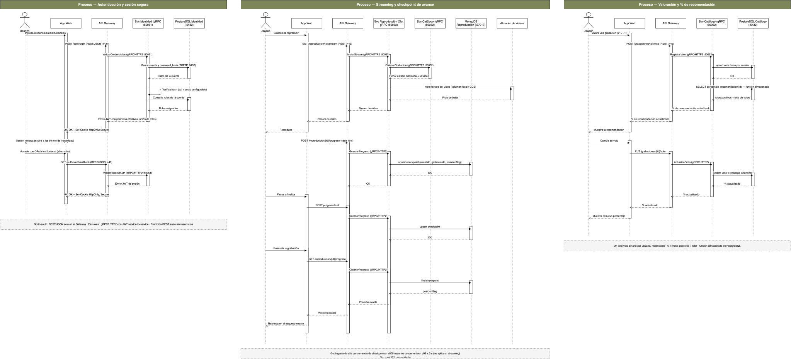
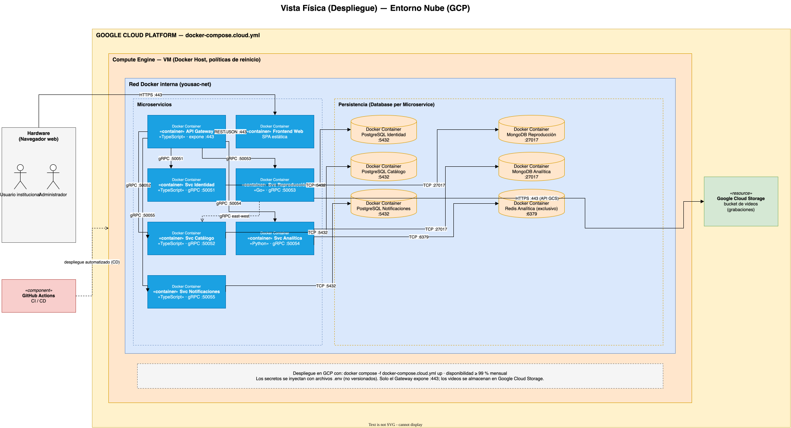

# Modelo de Vistas 4+1 — Plataforma YoUSAC

YoUSAC usa un frontend **Next.js**, un Gateway **NestJS** HTTPS y cinco microservicios internos gRPC/Protocol Buffers: Identidad, Catálogo y Notificaciones (TypeScript), Reproducción (Go) y Analítica (Python). Ningún microservicio expone REST al exterior.

## Vista lógica

Una persona institucional puede registrarse mediante formulario o OAuth, iniciar sesión, explorar catálogo, reproducir una clase, reanudarla, consultar historial y votar. El administrador asigna roles. La identidad valida los dominios configurados; las bases se relacionan entre servicios únicamente por identificadores lógicos.

## Vista de procesos

El navegador llama al Gateway por HTTPS y este traduce REST/JSON a gRPC/HTTP2, reenviando el JWT en metadatos internos. OAuth usa Authorization Code Flow y su retorno es exactamente `/api/auth/google/callback`; el Gateway valida `state`, el `id_token` y el dominio institucional antes de crear la sesión.

La sesión consiste en JWT y cookie `HttpOnly`, `Secure`, `SameSite=Strict`; su vigencia la controla `JWT_EXPIRES_IN`. El progreso de reproducción se guarda cada cinco segundos, al pausar y al finalizar, con `upsert` de MongoDB. Al recargar, el reproductor recibe el checkpoint exacto. Los deadlines gRPC se configuran mediante `GRPC_TIMEOUT_MS`.

## Vista de componentes

| Capa | Implementación |
|---|---|
| UI | Next.js, único cliente web |
| Exposición | Gateway NestJS HTTPS |
| Comunicación interna | `.proto`, gRPC/HTTP2 y JWT interno |
| Datos | una base por microservicio; Redis sólo para tendencias analíticas |
| Lógica programable | procedimiento de roles, función de recomendación, vistas y triggers |

El Gateway usa direcciones gRPC configurables y los servicios usan binds configurables, documentados en `.env.example`. Reproducción consulta Catálogo por gRPC y entrega el vídeo desde el volumen local. No se afirma caché de catálogo, una meta de concurrencia ni automatización CI/CD porque no forman parte de esta implementación verificada.

## Vista física

Docker Compose levanta tres PostgreSQL, dos MongoDB y Redis dentro de la red interna. Los healthchecks de las bases condicionan el arranque de los consumidores. El navegador solamente entra por el frontend HTTPS (`:3000`), que reenvía al Gateway HTTPS; los puertos gRPC permanecen internos.

La topología GCP/GCS es una referencia futura opcional; no es requisito ni evidencia de la Práctica 2. El almacenamiento probado localmente es el volumen de vídeos.

## Escenarios (+1)

Los escenarios de registro, OAuth, catálogo, reproducción, checkpoint, voto y RBAC conectan las cuatro vistas. El checkpoint se demuestra guardando cada cinco segundos, pausando, buscando, finalizando y recargando para restaurar la posición persistida. Los diagramas fuente editables y sus SVG están en [img/](img/).
