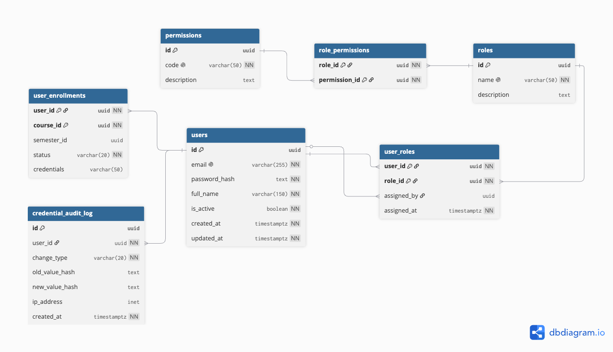
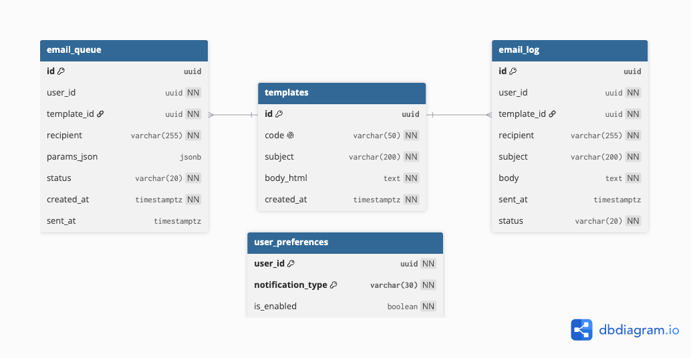
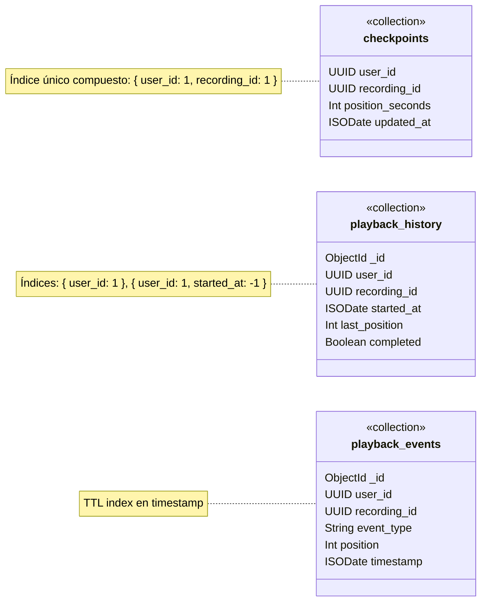
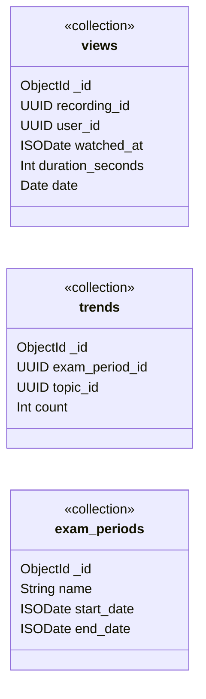

# Modelo Entidad-Relación — Plataforma YoUSAC

## Índice

- [Introducción](#introducción)
- [1. Topología de Persistencia Global](#1-topología-de-persistencia-global)
- [2. DER — Identidad (PostgreSQL)](#2-der--identidad-postgresql)
- [3. DER — Catálogo (PostgreSQL)](#3-der--catálogo-postgresql)
- [4. DER — Notificaciones (PostgreSQL)](#4-der--notificaciones-postgresql)
- [5. Colecciones — Reproducción (MongoDB)](#5-colecciones--reproducción-mongodb)
- [6. Persistencia — Analítica (MongoDB + Redis)](#6-persistencia--analítica-mongodb--redis)
- [7. Mapeo de Lógica Programable](#7-mapeo-de-lógica-programable)
- [Conclusiones](#conclusiones)

---

## Introducción

El modelo Entidad-Relación de YoUSAC documenta la persistencia de cada microservicio bajo el patrón **Database per Microservice**. La solución utiliza tres motores de persistencia distintos:

| Motor | Servicios | Uso principal |
|---|---|---|
| **PostgreSQL** | Identidad, Catálogo, Notificaciones | Datos relacionales con esquema estricto |
| **MongoDB** | Reproducción, Analítica | Alta concurrencia de escritura y esquemas flexibles |
| **Redis** | Analítica | Caché exclusiva con TTL |

Esta separación garantiza la autonomía de cada servicio, permite el escalamiento independiente y evita que una falla en una base de datos afecte a toda la plataforma.

> **Lógica programable:** cada base de datos incorpora procedimientos almacenados, vistas, funciones y triggers según los requerimientos **RNF-022** al **RNF-025**.

---

## 1. Topología de Persistencia Global

El diagrama de persistencia global presenta la topología completa: los cinco microservicios, sus respectivas bases de datos y las conexiones de acceso. Las líneas continuas representan conexiones directas a la base de datos; las líneas discontinuas representan comunicación **gRPC** entre servicios para obtener datos que residen en otra base de datos.

### Distribución de bases de datos

| Base de Datos | Motor | Servicio | Lenguaje | Puerto |
|---|---|---|---|---|
| `identity_db` | PostgreSQL | Identidad | TypeScript | `:5432` |
| `catalog_db` | PostgreSQL | Catálogo | TypeScript | `:5432` |
| `playback_db` | MongoDB | Reproducción | Go | `:27017` |
| `analytics_db` | MongoDB | Analítica | Python | `:27017` |
| `notification_db` | PostgreSQL | Notificaciones | TypeScript | `:5432` |
| Redis | Redis | Analítica | Python | `:6379` |

> **Nota:** el API Gateway no tiene base de datos propia. Los secretos de conexión se obtienen exclusivamente de archivos `.env` (RNF-011).

---

## 2. DER — Identidad (PostgreSQL)

El servicio de Identidad gestiona las cuentas de usuario, los roles, los permisos y la auditoría de cambios sensibles. Utiliza PostgreSQL con soporte completo de lógica programable.



> **Script de creación:** [`01-der-identidad.sql`](01-der-identidad.sql)

### Entidades

| Entidad | Descripción | `PK` | Atributos clave |
|---|---|---|---|
| `users` | Cuentas institucionales de la plataforma | `id` (`UUID`) | `email` (`UQ`), `password_hash`, `full_name`, `is_active`, `created_at`, `updated_at` |
| `roles` | Roles del sistema (Estudiante, Docente, Auxiliar, Admin) | `id` (`UUID`) | `name` (`UQ`), `description` |
| `permissions` | Permisos atómicos del sistema | `id` (`UUID`) | `code` (`UQ`), `description` |
| `role_permissions` | Asignación de permisos a roles (`N:N`) | `role_id` + `permission_id` | — |
| `user_roles` | Asignación de roles a usuarios (`N:N`) | `user_id` + `role_id` | `assigned_by` (`FK` → users), `assigned_at` |
| `user_enrollments` | Inscripción de estudiantes en cursos (RF-008, RF-026) | `user_id` + `course_id` | `semester_id` (ref. lógica → `catalog_db`), `status`, `credentials` |
| `credential_audit_log` | Auditoría de cambios de credenciales y roles | `id` (`UUID`) | `user_id` (`FK`), `change_type`, `old_value_hash`, `new_value_hash`, `ip_address`, `created_at` |

### Relaciones

```
users (1) ────── (N) user_roles   roles (1) ────── (N) role_permissions   permissions (1) ────── (N) role_permissions
```

- Un usuario puede tener múltiples roles; un rol puede estar asignado a múltiples usuarios.
- Un rol agrupa múltiples permisos; un permiso puede pertenecer a varios roles.

```
user_roles.assigned_by  ──────>  users.id
users (1) ────── (N) user_enrollments
users (1) ────── (N) credential_audit_log
```

- `user_roles.assigned_by` referencia al administrador que asignó el rol.
- Un estudiante puede estar inscrito en múltiples cursos (RF-008).
- Cada cambio de credenciales o roles genera un registro de auditoría.

### Lógica programable

| Tipo | Nombre | Tablas involucradas | Propósito |
|---|---|---|---|
| **SP** | `sp_assign_role` | `user_roles` | Asignar un rol a un usuario de forma transaccional. |
| **SP** | `sp_revoke_role` | `user_roles` | Revocar un rol de un usuario de forma transaccional. |
| **SP** | `sp_import_enrollments_csv` | `user_enrollments` | Carga masiva transaccional de inscripciones desde CSV (RF-026). |
| **FN** | `fn_accumulated_permissions` | `users`, `user_roles`, `role_permissions`, `permissions` | Calcular la unión de permisos de todos los roles de una cuenta. Retorna `TABLE(permission_code VARCHAR)`. |
| **VW** | `vw_user_profile` | `users`, `user_roles`, `roles` | Vista que simplifica la consulta del perfil de usuario con sus roles. |
| **TG** | `trg_audit_credentials` | `users` | `BEFORE UPDATE OF password_hash` — registra el cambio en `credential_audit_log`. |
| **TG** | `trg_audit_roles` | `user_roles` | `AFTER INSERT/UPDATE/DELETE` — registra cambios de asignación de roles en `credential_audit_log`. |

### Decisiones de diseño

> - Los permisos efectivos de una cuenta son la **unión** de los permisos de todos sus roles, sin necesidad de cambio de perfil.
> - Las contraseñas se almacenan con hash + salt y costo configurable (RNF-009).
> - No se modela una tabla de sesiones porque las sesiones se manejan mediante JWT + cookies y son stateless.
> - `user_enrollments` almacena inscripciones cargadas mediante CSV por el administrador (RF-026). Las referencias a `course_id` y `semester_id` son **lógicas** (no `FK` físicas) porque los datos maestros residen en `catalog_db`.

---

## 3. DER — Catálogo (PostgreSQL)

El servicio de Catálogo gestiona la estructura académica completa: escuelas, cursos, semestres, catedráticos, grabaciones y valoraciones. Es la base de datos con mayor cantidad de entidades y relaciones, y concentra la mayor parte de la lógica programable.


> **Script de creación:** [`02-der-catalogo.sql`](02-der-catalogo.sql)

### Entidades

| Entidad | Descripción | `PK` | Atributos clave |
|---|---|---|---|
| `schools` | Escuelas o áreas académicas | `id` (`UUID`) | `name`, `code` (`UQ`) |
| `courses` | Cursos de cada escuela | `id` (`UUID`) | `code` (`UQ`), `name`, `school_id` (`FK`), `credits` |
| `semesters` | Períodos académicos | `id` (`UUID`) | `year`, `term` (1=primer semestre, 2=segundo semestre) |
| `professors` | Catedráticos y auxiliares | `id` (`UUID`) | `full_name`, `email` (`UQ`) |
| `recordings` | Grabaciones de clases publicadas | `id` (`UUID`) | `title`, `course_id` (`FK`), `semester_id` (`FK`), `lecture_date`, `unit`, `topic`, `video_path`, `is_published`, `created_at` |
| `recording_professors` | Asignación de catedráticos a grabaciones | `recording_id` + `professor_id` | `role_type` (`'professor'` \| `'assistant'`) |
| `topics` | Temas y etiquetas académicas | `id` (`UUID`) | `name` (`UQ`) |
| `recording_topics` | Asignación de temas a grabaciones | `recording_id` + `topic_id` | — |
| `attachments` | Materiales adjuntos a grabaciones | `id` (`UUID`) | `recording_id` (`FK`), `filename`, `file_path`, `file_type` |
| `ratings` | Valoraciones de usuarios sobre grabaciones | `user_id` + `recording_id` | `vote` (`BOOLEAN`: `true`=positivo), `updated_at` |

### Relaciones

```
schools (1) ────── (N) courses
courses (1) ────── (N) recordings
semesters (1) ────── (N) recordings
recordings (1) ────── (N) recording_professors   professors (1) ────── (N) recording_professors
recordings (1) ────── (N) recording_topics       topics (1) ────── (N) recording_topics
recordings (1) ────── (N) attachments
recordings (1) ────── (N) ratings
```

- Una escuela ofrece múltiples cursos.
- Un curso tiene múltiples grabaciones.
- Un semestre agrupa múltiples grabaciones.
- Una grabación puede tener varios docentes y auxiliares.
- Una grabación puede tener múltiples etiquetas temáticas.
- Una grabación puede incluir materiales adjuntos.
- Cada grabación acumula valoraciones de los usuarios.

### Lógica programable

| Tipo | Nombre | Propósito |
|---|---|---|
| **VW** | `vw_catalog` | Vista principal del catálogo. Realiza `JOIN` de `recordings`, `courses`, `schools` y `semesters`. Permite filtrar por escuela, curso, semestre, catedrático (vía `recording_professors`) y tema (vía `recording_topics`). |
| **VW** | `vw_recording_detail` | Ficha técnica completa de una grabación: curso, semestre, fecha de impartición, unidad, tema, docentes, auxiliares, materiales adjuntos y sílabo. |
| **FN** | `fn_recommendation_pct(recording_id UUID)` | Calcula el porcentaje de recomendación: votos positivos ÷ total de votos. Retorna `DECIMAL`. |
| **FN** | `fn_top_rated(limit INT)` | Retorna una tabla con el ranking de grabaciones por porcentaje de recomendación. |
| **SP** | `sp_import_catalog_csv` | Carga masiva transaccional de datos de catálogo desde CSV (`schools`, `courses`, `semesters`). |
| **SP** | `sp_import_recordings_csv` | Carga masiva transaccional de grabaciones desde CSV. |

### Decisiones de diseño

> - Las vistas permiten a TypeScript realizar consultas complejas sin lógica de `JOIN` en el código, cumpliendo RNF-023.
> - La función `fn_recommendation_pct` ejecuta el cálculo en la base de datos y devuelve el porcentaje actualizado en una sola operación (RNF-024).
> - Los catedráticos y auxiliares se modelan en la misma tabla `professors`; el tipo de participación en una grabación se distingue mediante `role_type` en la tabla de rompimiento `recording_professors`.

---

## 4. DER — Notificaciones (PostgreSQL)

El servicio de Notificaciones gestiona el envío de correos electrónicos institucionales, incluyendo plantillas reutilizables, preferencias de usuario, una cola de envío y un historial de auditoría.



> **Script de creación:** [`03-der-notificaciones.sql`](03-der-notificaciones.sql)

### Entidades

| Entidad | Descripción | `PK` | Atributos clave |
|---|---|---|---|
| `templates` | Plantillas de correo reutilizables | `id` (`UUID`) | `code` (`UQ`), `subject`, `body_html`, `created_at` |
| `user_preferences` | Preferencias de notificación por usuario | `user_id` + `notification_type` | `is_enabled` (`BOOLEAN`) |
| `email_queue` | Cola de correos pendientes de envío | `id` (`UUID`) | `user_id`, `template_id` (`FK`), `recipient`, `params_json` (`JSONB`), `status`, `created_at`, `sent_at` |
| `email_log` | Historial de correos enviados | `id` (`UUID`) | `user_id`, `template_id` (`FK`), `recipient`, `subject`, `body`, `sent_at`, `status` |

### Relaciones

```
templates (1) ────── (N) email_queue
templates (1) ────── (N) email_log
```

- Una plantilla puede estar referenciada en múltiples correos pendientes.
- Una plantilla puede estar referenciada en múltiples correos históricos.

### Lógica programable

| Tipo | Nombre | Propósito |
|---|---|---|
| **SP** | `sp_enqueue_notification` | Procedimiento transaccional que: (1) verifica `user_preferences.is_enabled` para el tipo de notificación, (2) resuelve la plantilla por código, (3) inserta en `email_queue` con `status='pending'` y (4) registra en `email_log` con `status='queued'`. |
| **VW** | `vw_queue_status` | Vista de monitoreo que une `email_queue` y `templates`, agrupando por `status` (`pending`, `sent`, `failed`). |

### Decisiones de diseño

> - `user_preferences` usa una clave compuesta por `user_id` + `notification_type`. Los correos de seguridad y recuperación no son deshabilitables por el usuario.
> - `email_queue.params_json` almacena los parámetros dinámicos en `JSONB`, lo que permite que cada plantilla reciba distintos campos sin modificar el esquema.
> - `email_log` conserva una copia inmutable del contenido enviado (`subject`, `body`) para auditoría, incluso si la plantilla original se modifica posteriormente.
> - El envío máximo de 5 minutos desde la generación (RNF-006) se implementa mediante un worker en TypeScript que consulta `email_queue` periódicamente.

---

## 5. Colecciones — Reproducción (MongoDB)

El servicio de Reproducción (Go) utiliza MongoDB para almacenar los checkpoints de avance, el historial de reproducción y los eventos de interacción. MongoDB fue elegido para este dominio por su capacidad de escritura de alta concurrencia, necesaria para ingestar checkpoints cada 10 segundos de hasta 500 usuarios simultáneos.

> **Nota:** dbdiagram.io está pensado para esquemas relacionales. Para MongoDB se utiliza Mermaid; la representación DBML es solo aproximada.



> **Fuente:** [`04_colecciones_reproduccion.png`](img/04_colecciones_reproduccion.png)  
> **Script de creación:** [`04-colecciones-reproduccion.js`](04-colecciones-reproduccion.js)

### `checkpoints`

Almacena la posición exacta de reproducción por usuario y grabación.

```javascript
{
  user_id:            UUID,
  recording_id:       UUID,
  position_seconds:   INT,
  updated_at:         ISODate
}
```

- **`Índice único compuesto`:** `{ user_id: 1, recording_id: 1 }`
- **Estrategia:** operación `upsert` cada 10 segundos y en los eventos de pausa/detención (RF-014). Un usuario solo puede tener un checkpoint por grabación; el `upsert` sobrescribe la posición anterior.

---

### `playback_history`

Registra cada reproducción iniciada por un usuario.

```javascript
{
  _id:            ObjectId,
  user_id:        UUID,
  recording_id:   UUID,
  started_at:     ISODate,
  last_position:  INT,
  completed:      BOOLEAN
}
```

- **`Índices`:** `{ user_id: 1 }` y `{ user_id: 1, started_at: -1 }`
- **Estrategia:** se inserta un nuevo documento al iniciar cada reproducción. La consulta del historial obtiene los 20 documentos más recientes ordenados por `started_at` descendente (RF-016).

---

### `playback_events`

Registro detallado de eventos de interacción durante la reproducción.

```javascript
{
  _id:            ObjectId,
  user_id:        UUID,
  recording_id:   UUID,
  event_type:     STRING,     // "play" | "pause" | "stop" | "seek"
  position:       INT,
  timestamp:      ISODate     // TTL index
}
```

- **`TTL index`** en `timestamp` para eliminación automática después de un período configurable.
- **Estrategia:** utilizado para analítica de comportamiento de visualización. El TTL evita el crecimiento ilimitado de esta colección.

### Relaciones lógicas

> En MongoDB no existen `foreign keys` físicas. Las relaciones entre colecciones son **lógicas**, basadas en los campos `user_id` y `recording_id` que actúan como referencias compartidas.

---

## 6. Persistencia — Analítica (MongoDB + Redis)

El servicio de Analítica (Python) utiliza **MongoDB** para almacenamiento persistente de datos analíticos (visualizaciones, tendencias y períodos de examen) y **Redis** como caché exclusiva para acelerar consultas frecuentes durante picos de concurrencia.

> **Nota:** dbdiagram.io está pensado para esquemas relacionales. Para MongoDB se utiliza Mermaid; la representación DBML es solo aproximada.



> **Fuente:** [`05_colecciones_analitica.png`](img/05_colecciones_analitica.png)  
> **Script de creación:** [`05-colecciones-analitica.js`](05-colecciones-analitica.js)

### MongoDB — Colecciones

#### `views`

Registro de cada visualización de una grabación.

```javascript
{
  _id:              ObjectId,
  recording_id:     UUID,
  user_id:          UUID,
  watched_at:       ISODate,
  duration_seconds: INT,
  date:             DATE
}
```

---

#### `trends`

Conteo de temas en tendencia por período de examen.

```javascript
{
  _id:             ObjectId,
  exam_period_id:  UUID,
  topic_id:        UUID,
  count:           INT
}
```

---

#### `exam_periods`

Períodos de examen configurados por el administrador.

```javascript
{
  _id:         ObjectId,
  name:        STRING,
  start_date:  ISODate,
  end_date:    ISODate
}
```

### Redis — Patrones de caché

Redis es una instancia exclusiva del servicio de Analítica (RNF-019). Almacena en memoria los datos más consultados para evitar sobrecargar PostgreSQL y MongoDB durante picos de concurrencia.

| Key Pattern | Tipo | TTL | Propósito | Requerimiento |
|---|---|---|---|---|
| `catalog:{filter_hash}` | `STRING` (JSON) | 15 min | Caché de resultados de búsqueda del catálogo | RNF-004 |
| `trends:{period_id}` | `SORTED SET` | 5 min | Temas más populares en un período de examen | RNF-005 |
| `weekly_top:{monday_date}` | `SORTED SET` | 7 días | Grabaciones más vistas de la semana | RF-019 |
| `top_rated` | `SORTED SET` | 30 min | Ranking por porcentaje de recomendación | RF-022 |
| `recommendations:{user_id}` | `LIST` | 1 hora | Recomendaciones personalizadas cacheadas | RF-023 |

### Flujo de cálculo de recomendaciones

Las recomendaciones personalizadas (RF-023) se calculan mediante el siguiente flujo de datos entre microservicios:

```
Python consulta inscripciones  ──────gRPC──────>  Servicio Identidad
Python consulta historial      ──────gRPC──────>  Servicio Reproducción
Python consulta votos          ──────gRPC──────>  Servicio Catálogo
        │
        ▼
Cruce con catálogo completo  (Redis catalog:*  o vía gRPC a Catálogo)
        │
        ▼
Almacena en  recommendations:{user_id}  (TTL 1 hora)
```

---

## 7. Mapeo de Lógica Programable

Este es el inventario completo de la lógica programable por base de datos, según lo requerido por el enunciado de la práctica y las decisiones de contexto.

### `identity_db` (PostgreSQL)

| Tipo | Objeto | Justificación |
|---|---|---|
| **SP** | `sp_assign_role` | RNF-022 — flujo transaccional de asignación de roles. |
| **SP** | `sp_revoke_role` | RNF-022 — flujo transaccional de revocación de roles. |
| **SP** | `sp_import_enrollments_csv` | RF-026 — flujo transaccional de importación masiva de inscripciones. |
| **FN** | `fn_accumulated_permissions` | Cálculo de permisos efectivos como unión de roles. |
| **VW** | `vw_user_profile` | Simplifica la consulta del perfil de usuario. |
| **TG** | `trg_audit_credentials` | RNF-025 — auditoría de cambios de credenciales. |
| **TG** | `trg_audit_roles` | RNF-025 — auditoría de cambios de roles. |

---

### `catalog_db` (PostgreSQL)

| Tipo | Objeto | Justificación |
|---|---|---|
| **VW** | `vw_catalog` | RNF-023 — simplifica la consulta del catálogo con filtros. |
| **VW** | `vw_recording_detail` | RNF-023 — simplifica la ficha técnica detallada. |
| **FN** | `fn_recommendation_pct` | RNF-024 — cálculo del % de recomendación en BD. |
| **FN** | `fn_top_rated` | Ranking dinámico de grabaciones mejor valoradas. |
| **SP** | `sp_import_catalog_csv` | Flujo transaccional de importación masiva (RF-024). |
| **SP** | `sp_import_recordings_csv` | Flujo transaccional de importación masiva (RF-025). |

---

### `notification_db` (PostgreSQL)

| Tipo | Objeto | Justificación |
|---|---|---|
| **SP** | `sp_enqueue_notification` | Flujo transaccional: verifica preferencias, resuelve plantilla, encola y registra. |
| **VW** | `vw_queue_status` | Monitoreo del estado de la cola de envío. |

---

### `playback_db` (MongoDB)

MongoDB no soporta stored procedures, vistas ni triggers en el sentido tradicional de PostgreSQL. La lógica programable se implementa en el código Go mediante:

- **Upsert operations** en `checkpoints` (equivalente funcional a un SP).
- **TTL indexes** en `playback_events` (equivalente funcional a un trigger de limpieza).
- **Aggregation pipelines** para consultas analíticas sobre el historial.

---

### `analytics_db` (MongoDB + Redis)

La lógica de Analítica se implementa en Python:

- **Aggregation pipelines** en MongoDB para calcular tendencias, vistas semanales y rankings.
- **Pipeline de recomendaciones** que orquesta llamadas gRPC a Identidad, Reproducción y Catálogo.
- **Redis SET/GET con TTL** para la caché de catálogo, tendencias y recomendaciones.

---

## Conclusiones

- El modelo Entidad-Relación de YoUSAC se diseñó bajo el patrón **Database per Microservice**, con cinco bases de datos independientes y una instancia de Redis exclusiva para Analítica, garantizando la autonomía y el escalamiento independiente de cada servicio.
- La **matriz políglota** de persistencia combina PostgreSQL (tres instancias) para datos relacionales con esquemas estrictos (usuarios, catálogo, notificaciones) y MongoDB (dos instancias) para datos de alta concurrencia de escritura y esquemas flexibles (checkpoints, analítica).
- Se mapearon **8 procedimientos almacenados**, **6 vistas**, **4 funciones** y **2 triggers** sobre las bases de datos PostgreSQL, cumpliendo los requerimientos RNF-022 a RNF-025 y las decisiones de contexto sobre lógica programable.
- Redis se configuró con **5 patrones de clave** con TTL diferenciados por dominio (15 min para catálogo, 5 min para tendencias), cumpliendo los requerimientos de caché (RNF-004, RNF-005) y evitando la sobrecarga de las bases de datos durante picos de concurrencia.
- Las relaciones entre microservicios se modelaron como referencias lógicas por ID (no existen llaves foráneas físicas entre bases de datos distintas). Toda comunicación entre servicios para obtener datos de otro dominio se realiza exclusivamente mediante gRPC.
