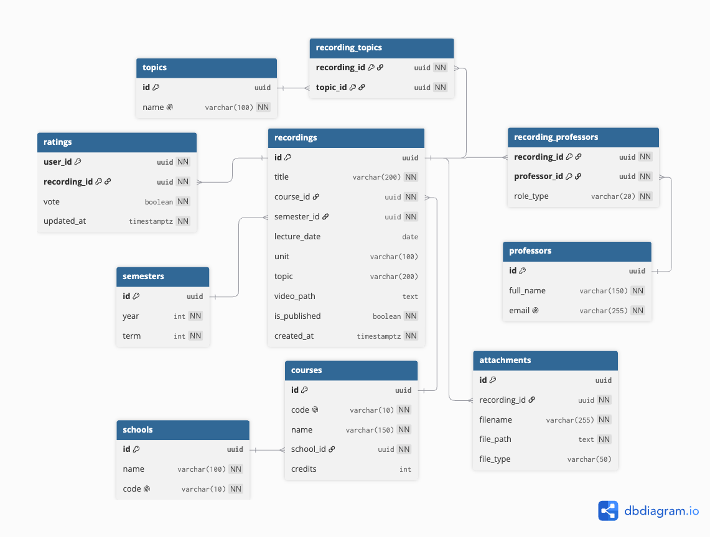
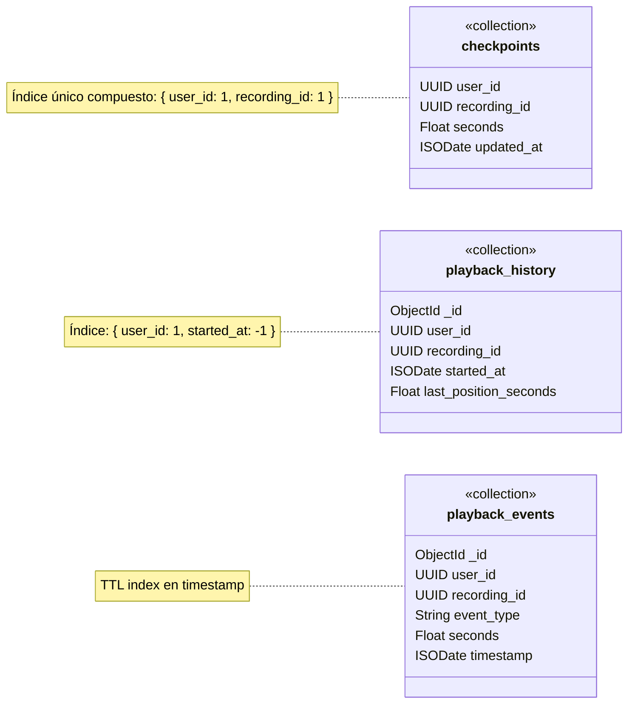
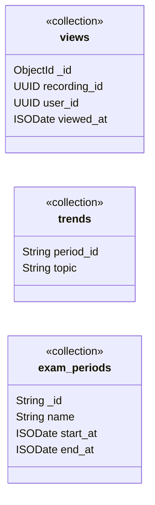

# Modelo Entidad-Relación — Plataforma YoUSAC

## Índice

- [Introducción](#introducción)
- [1. Topología de Persistencia Global](#1-topología-de-persistencia-global)
- [2. DER — Identidad (PostgreSQL)](#2-der--identidad-postgresql)
- [3. DER — Catálogo (PostgreSQL)](#3-der--catálogo-postgresql)
- [4. DER — Notificaciones (PostgreSQL)](#4-der--notificaciones-postgresql)
- [5. Colecciones — Reproducción (MongoDB)](#5-colecciones--reproducción-mongodb)
- [6. Persistencia — Analítica (MongoDB + Redis)](#6-persistencia--analítica-mongodb--redis)
- [7. Mapeo de Lógica Programable](#7-mapeo-de-lógica-programable)
- [Conclusiones](#conclusiones)

---

## Introducción

El modelo Entidad-Relación de YoUSAC documenta la persistencia de cada microservicio bajo el patrón **Database per Microservice**. La solución utiliza tres motores de persistencia distintos:

| Motor | Servicios | Uso principal |
|---|---|---|
| **PostgreSQL** | Identidad, Catálogo, Notificaciones | Datos relacionales con esquema estricto |
| **MongoDB** | Reproducción, Analítica | Alta concurrencia de escritura y esquemas flexibles |
| **Redis** | Analítica | Caché exclusiva con TTL |

Esta separación garantiza la autonomía de cada servicio, permite el escalamiento independiente y evita que una falla en una base de datos afecte a toda la plataforma.

> **Lógica programable:** las bases PostgreSQL incorporan procedimientos, vistas, funciones y triggers según el dominio. En Notificaciones, Reproducción y Analítica la lógica equivalente reside en el código de aplicación, los workers, los pipelines y los índices de cada motor.

---

## 1. Topología de Persistencia Global

El diagrama de persistencia global presenta la topología completa: los cinco microservicios, sus respectivas bases de datos y las conexiones de acceso. Las líneas continuas representan conexiones directas a la base de datos; las líneas discontinuas representan comunicación **gRPC** entre servicios para obtener datos que residen en otra base de datos.

### Distribución de bases de datos

| Base de Datos | Motor | Servicio | Lenguaje | Puerto |
|---|---|---|---|---|
| `identity_db` | PostgreSQL | Identidad | TypeScript | `:5432` |
| `catalog_db` | PostgreSQL | Catálogo | TypeScript | `:5432` |
| `playback_db` | MongoDB | Reproducción | Go | `:27017` |
| `analytics_db` | MongoDB | Analítica | Python | `:27017` |
| `notification_db` | PostgreSQL | Notificaciones | TypeScript | `:5432` |
| Redis | Redis | Analítica | Python | `:6379` |

> **Nota:** el API Gateway no tiene base de datos propia. Los secretos de conexión se obtienen exclusivamente de archivos `.env` (RNF-011).

---

## 2. DER — Identidad (PostgreSQL)

El servicio de Identidad gestiona las cuentas de usuario, los roles, los permisos y la auditoría de cambios sensibles. Utiliza PostgreSQL con soporte completo de lógica programable.


> **Script de creación:** [`01-der-identidad.sql`](01-der-identidad.sql)

### Entidades

| Entidad | Descripción | `PK` | Atributos clave |
|---|---|---|---|
| `users` | Cuentas institucionales de la plataforma | `id` (`UUID`) | `email` (`UQ`), `password_hash`, `full_name`, `is_active`, `created_at`, `updated_at` |
| `password_reset_tokens` | Mecanismos temporales de recuperación | `id` (`UUID`) | `user_id` (`FK`), `token_hash` (`UQ`), `expires_at`, `used_at`, `created_at` |
| `roles` | Roles del sistema (Estudiante, Docente, Auxiliar, Admin) | `id` (`UUID`) | `name` (`UQ`), `description` |
| `permissions` | Permisos atómicos del sistema | `id` (`UUID`) | `code` (`UQ`), `description` |
| `role_permissions` | Asignación de permisos a roles (`N:N`) | `role_id` + `permission_id` | — |
| `user_roles` | Asignación de roles a usuarios (`N:N`) | `user_id` + `role_id` | `assigned_by` (`FK` → users), `assigned_at` |
| `user_enrollments` | Inscripción de estudiantes en cursos (RF-008, RF-026) | `user_id` + `course_id` + `semester_id` | `course_id` y `semester_id` (ref. lógica → `catalog_db`), `status`, `credentials` |
| `credential_audit_log` | Auditoría de cambios de credenciales y roles | `id` (`UUID`) | `user_id` (`FK`), `change_type`, `old_value_hash`, `new_value_hash`, `ip_address`, `created_at` |

### Relaciones

```
users (1) ────── (N) user_roles   roles (1) ────── (N) role_permissions   permissions (1) ────── (N) role_permissions
users (1) ────── (N) password_reset_tokens
```

- Un usuario puede tener múltiples roles; un rol puede estar asignado a múltiples usuarios.
- Un rol agrupa múltiples permisos; un permiso puede pertenecer a varios roles.

```
user_roles.assigned_by  ──────>  users.id
users (1) ────── (N) user_enrollments
users (1) ────── (N) credential_audit_log
```

- `user_roles.assigned_by` referencia al administrador que asignó el rol.
- Un estudiante puede estar inscrito en múltiples cursos (RF-008).
- Cada cambio de credenciales o roles genera un registro de auditoría.
- Los tokens de recuperación se almacenan como SHA-256, expiran en 30 minutos y se invalidan al consumirse.

### Lógica programable

| Tipo | Nombre | Tablas involucradas | Propósito |
|---|---|---|---|
| **SP** | `set_user_role(p_user, p_role, p_assign, p_actor)` | `user_roles` | Asignar o revocar un rol a un usuario de forma transaccional. |
| **SP** | `sp_import_enrollments_csv` | `user_enrollments` | Carga masiva transaccional de inscripciones desde CSV (RF-026). |
| **FN** | `get_user_permissions(p_user)` | `users`, `user_roles`, `role_permissions`, `permissions` | Calcular los permisos efectivos de una cuenta a partir de sus roles. Retorna `role_name` y `permission_code`. |
| **FN/TG** | `audit_identity_change()` / `user_roles_audit` | `user_roles`, `credential_audit_log` | Auditar inserciones y eliminaciones de asignaciones de roles. |
| **FN/TG** | `audit_password_change()` / `users_password_audit` | `users`, `credential_audit_log` | Auditar cambios de `password_hash` guardando hashes SHA-256 de los valores anterior y nuevo. |

### Decisiones de diseño

> - Los permisos efectivos de una cuenta son la **unión** de los permisos de todos sus roles, sin necesidad de cambio de perfil.
> - Las contraseñas se almacenan con hash + salt y costo configurable (RNF-009).
> - No se modela una tabla de sesiones porque las sesiones se manejan mediante JWT + cookies y son stateless.
> - `user_enrollments` almacena inscripciones cargadas mediante CSV por el administrador (RF-026). Las referencias a `course_id` y `semester_id` son **lógicas** (no `FK` físicas) porque los datos maestros residen en `catalog_db`.

---

## 3. DER — Catálogo (PostgreSQL)

El servicio de Catálogo gestiona la estructura académica completa: escuelas, cursos, semestres, catedráticos, grabaciones, temas, materiales y valoraciones. La ficha detallada se construye desde este servicio y sus datos se exponen al Gateway mediante gRPC.



> **Script de creación:** [`02-der-catalogo.sql`](02-der-catalogo.sql)

### Entidades

| Entidad | Descripción | `PK` | Atributos clave |
|---|---|---|---|
| `schools` | Escuelas o áreas académicas | `id` (`UUID`) | `name`, `code` (`UQ`), `is_active` |
| `courses` | Cursos de cada escuela | `id` (`UUID`) | `code` (`UQ`), `name`, `school_id` (`FK`), `credits`, `is_active` |
| `semesters` | Períodos académicos | `id` (`UUID`) | `year`, `term` (1=primer semestre, 2=segundo semestre), `is_active` |
| `professors` | Catedráticos y auxiliares | `id` (`UUID`) | `full_name`, `email` (`UQ`), `is_active` |
| `course_staff` | Asignación de profesores y auxiliares a cursos | `course_id` + `professor_id` | `role_type`, `assigned_by_email`, `assigned_at` |
| `recordings` | Grabaciones de clases publicadas | `id` (`UUID`) | `title`, `course_id` (`FK`), `semester_id` (`FK`), `lecture_date`, `unit`, `topic` (legado), `video_path`, `is_published`, `is_active`, `created_at` |
| `recording_professors` | Asignación de participantes a grabaciones | `recording_id` + `professor_id` | `role_type` (`'professor'` \| `'assistant'`) |
| `topics` | Temas y etiquetas académicas | `id` (`UUID`) | `name`, único mediante `lower(name)` |
| `recording_topics` | Asignación de temas a grabaciones | `recording_id` + `topic_id` | — |
| `attachments` | Sílabo y materiales adjuntos | `id` (`UUID`) | `recording_id` (`FK`), `filename`, `file_path`, `file_type`, `attachment_type`, `created_at` |
| `ratings` | Valoraciones de usuarios sobre grabaciones | `user_id` + `recording_id` | `vote` (`BOOLEAN`: `true`=positivo), `updated_at` |

### Relaciones

```
schools (1) ────── (N) courses
courses (1) ────── (N) recordings
semesters (1) ────── (N) recordings
courses (1) ────── (N) course_staff   professors (1) ────── (N) course_staff
recordings (1) ────── (N) recording_professors   professors (1) ────── (N) recording_professors
recordings (1) ────── (N) recording_topics       topics (1) ────── (N) recording_topics
recordings (1) ────── (N) attachments
recordings (1) ────── (N) ratings
```

- Una escuela ofrece múltiples cursos.
- Un curso tiene múltiples grabaciones.
- Un semestre agrupa múltiples grabaciones.
- Un curso puede tener múltiples profesores y auxiliares mediante `course_staff`.
- Una grabación puede tener varios docentes y auxiliares.
- Una grabación puede tener múltiples etiquetas temáticas.
- Una grabación puede incluir materiales adjuntos.
- Cada grabación acumula valoraciones de los usuarios.

### Lógica programable

| Tipo | Nombre | Propósito |
|---|---|---|
| **VW** | `published_catalog` | Vista principal del catálogo publicado. Realiza `JOIN` de `recordings`, `courses`, `schools`, `semesters` y agrega las etiquetas. |
| **VW** | `recording_detail` | Vista base de la ficha técnica: curso, semestre, fecha de impartición, unidad y temas. El repositorio complementa docentes, auxiliares y adjuntos en consultas del mismo servicio. |
| **FN** | `recommendation_percentage(recording_id UUID)` | Calcula el porcentaje de recomendación: votos positivos ÷ total de votos. Retorna `DECIMAL`. |
| **TG** | `touch_rating()` / `ratings_updated` | Actualiza `ratings.updated_at` antes de modificar una valoración. |
| **SP** | `sp_assign_course_staff` | Asigna un profesor o auxiliar a un curso. |
| **SP** | `sp_revoke_course_staff` | Revoca una asignación de profesor o auxiliar de un curso. |
| **SP** | `sp_import_catalog_csv` | Carga masiva transaccional de datos de catálogo desde CSV (`schools`, `courses`, `semesters`). |
| **SP** | `sp_import_recordings_csv` | Carga masiva transaccional de grabaciones, participantes, temas y metadatos de adjuntos desde CSV. |

### Decisiones de diseño

> - Las vistas permiten a TypeScript realizar consultas complejas sin lógica de `JOIN` en el código, cumpliendo RNF-023.
> - La función `recommendation_percentage` ejecuta el cálculo en la base de datos y devuelve el porcentaje actualizado en una sola operación (RNF-024).
> - Los catedráticos y auxiliares se modelan en la misma tabla `professors`; el tipo de participación en una grabación se distingue mediante `role_type` en la tabla de rompimiento `recording_professors`.
> - Los temas se normalizan en `topics` y se relacionan con `recording_topics`; el campo legado `recordings.topic` se conserva para compatibilidad con importaciones anteriores.
> - P5 almacena únicamente metadatos y URL/ruta de materiales. La carga binaria queda fuera de P5; los videos de reproducción se resuelven desde almacenamiento local o GCS según la configuración de Playback.

---

## 4. DER — Notificaciones (PostgreSQL)

El servicio de Notificaciones gestiona el envío de correos electrónicos institucionales, incluyendo plantillas reutilizables, preferencias de usuario, una cola de envío y un historial de auditoría.


> **Script de creación:** [`03-der-notificaciones.sql`](03-der-notificaciones.sql)

### Entidades

| Entidad | Descripción | `PK` | Atributos clave |
|---|---|---|---|
| `templates` | Plantillas de correo reutilizables | `id` (`UUID`) | `code` (`UQ`), `subject`, `body_html`, `created_at` |
| `user_preferences` | Preferencias de notificación por usuario | `user_id` + `notification_type` | `is_enabled` (`BOOLEAN`) |
| `email_queue` | Cola de correos pendientes de envío | `id` (`UUID`) | `user_id` (ref. lógica), `template_id` (`FK opcional`), `recipient`, `params_json` (`JSONB`), `status`, `attempts`, `available_at`, `last_error`, `created_at`, `sent_at` |
| `email_log` | Historial de correos enviados y fallidos | `id` (`UUID`) | `user_id` (ref. lógica), `template_id` (`FK opcional`), `recipient`, `subject`, `body`, `sent_at`, `status` |

### Relaciones

```
templates (1) ────── (N) email_queue
templates (1) ────── (N) email_log
```

- Una plantilla puede estar referenciada en múltiples correos pendientes.
- Una plantilla puede estar referenciada en múltiples correos históricos.
- `user_id` referencia lógicamente a `identity_db.users.id`; no existe una FK entre microservicios.
- `status` en `email_queue` admite `pending`, `processing`, `sent` y `failed`.
- Las plantillas disponibles son `registration`, `recovery`, `security`, `new_recording` y `admin_notice`.

### Lógica programable

| Tipo | Nombre | Propósito |
|---|---|---|
| **Código** | `NotificationsRepository.enqueue` / `enqueueBatch` | Verifica preferencias opcionales, resuelve la plantilla y encola en `email_queue` con `status='pending'`. |
| **Worker** | `NotificationsWorker` | Reclama lotes disponibles con `FOR UPDATE SKIP LOCKED`, entrega por SMTP/Mailpit, actualiza estados, registra `email_log` y reintenta hasta cuatro veces. |
| **Índice** | `email_queue_pending_idx` | Acelera la búsqueda de correos `pending` o `processing` cuya fecha `available_at` ya venció. |

### Decisiones de diseño

> - `user_preferences` usa una clave compuesta por `user_id` + `notification_type`. Los correos de seguridad y recuperación no son deshabilitables por el usuario.
> - Las preferencias editables son `new_recording` y `admin_notice`; `registration`, `recovery` y `security` se procesan como correos obligatorios según el flujo.
> - `email_queue.params_json` almacena los parámetros dinámicos en `JSONB`, lo que permite que cada plantilla reciba distintos campos sin modificar el esquema.
> - `email_log` conserva una copia del contenido entregado (`subject`, `body`) y de los fallos terminales para auditoría, incluso si la plantilla original se modifica posteriormente.
> - El envío máximo de 5 minutos desde la generación (RNF-006) se implementa mediante un worker en TypeScript que procesa inmediatamente al iniciar y después cada 30 segundos.

---

## 5. Colecciones — Reproducción (MongoDB)

El servicio de Reproducción (Go) utiliza MongoDB para almacenar los checkpoints de avance, el historial de reproducción y los eventos de interacción. MongoDB fue elegido para este dominio por su capacidad de escritura de alta concurrencia, necesaria para ingestar checkpoints cada 10 segundos de hasta 500 usuarios simultáneos.

> **Nota:** dbdiagram.io está pensado para esquemas relacionales. Para MongoDB se utiliza Mermaid; la representación DBML es solo aproximada.



> **Fuente:** [`04_colecciones_reproduccion.png`](img/04_colecciones_reproduccion.png)  
> **Script de creación:** [`04-colecciones-reproduccion.js`](04-colecciones-reproduccion.js)

### `checkpoints`

Almacena la posición exacta de reproducción por usuario y grabación.

```javascript
{
  user_id:            UUID,
  recording_id:       UUID,
  seconds:            FLOAT,
  updated_at:         ISODate
}
```

- **`Índice único compuesto`:** `{ user_id: 1, recording_id: 1 }`
- **Estrategia:** operación `upsert` cada 10 segundos y en los eventos de pausa/detención (RF-014). Un usuario solo puede tener un checkpoint por grabación; el `upsert` sobrescribe la posición anterior.

---

### `playback_history`

Mantiene el último avance de cada usuario y grabación.

```javascript
{
  _id:            ObjectId,
  user_id:        UUID,
  recording_id:   UUID,
  started_at:     ISODate,
  last_position_seconds: FLOAT
}
```

- **`Índice`:** `{ user_id: 1, started_at: -1 }`
- **Estrategia:** el servicio mantiene un documento por usuario y grabación mediante `upsert`, actualiza `last_position_seconds` y `started_at`, y consulta los 20 registros más recientes ordenados por `started_at` descendente (RF-016).

---

### `playback_events`

Registro detallado de eventos de interacción durante la reproducción.

```javascript
{
  _id:            ObjectId,
  user_id:        UUID,
  recording_id:   UUID,
  event_type:     STRING,     // "play" | "pause" | "stop" | "seek"
  seconds:        FLOAT,
  timestamp:      ISODate     // TTL index
}
```

- **`TTL index`** en `timestamp` con `expireAfterSeconds=2592000` (30 días) para eliminación automática.
- **Estrategia:** utilizado para analítica de comportamiento de visualización. El TTL evita el crecimiento ilimitado de esta colección.

### Relaciones lógicas

> En MongoDB no existen `foreign keys` físicas. Las relaciones entre colecciones son **lógicas**, basadas en los campos `user_id` y `recording_id` que actúan como referencias compartidas.

---

## 6. Persistencia — Analítica (MongoDB + Redis)

El servicio de Analítica (Python) utiliza **MongoDB** para almacenamiento persistente de datos analíticos (visualizaciones, tendencias y períodos de examen) y **Redis** como caché exclusiva para acelerar consultas frecuentes durante picos de concurrencia.

> **Nota:** dbdiagram.io está pensado para esquemas relacionales. Para MongoDB se utiliza Mermaid; la representación DBML es solo aproximada.



> **Fuente:** [`05_colecciones_analitica.png`](img/05_colecciones_analitica.png)  
> **Script de creación:** [`05-colecciones-analitica.js`](05-colecciones-analitica.js)

### MongoDB — Colecciones

#### `views`

Registro de cada visualización de una grabación.

```javascript
{
  _id:              ObjectId,
  recording_id:     UUID,
  user_id:          UUID,
  viewed_at:        ISODate
}
```

---

#### `trends`

Resultados materializados de tendencias por período de examen; el conteo final se calcula en el pipeline de Analítica y se cachea en Redis.

```javascript
{
  period_id:       STRING,
  topic:           STRING
}
```

---

#### `exam_periods`

Períodos de examen configurados por el administrador.

```javascript
{
  _id:       STRING,
  name:      STRING,
  start_at:  ISODate,
  end_at:    ISODate
}
```

### Redis — Patrones de caché

Redis es una instancia exclusiva del servicio de Analítica (RNF-019). Almacena en memoria los datos más consultados para evitar sobrecargar PostgreSQL y MongoDB durante picos de concurrencia.

| Key Pattern | Tipo | TTL | Propósito | Requerimiento |
|---|---|---|---|---|
| `analytics:catalog:<filtros>` | `STRING` (JSON) | 900 s | Caché del catálogo paginado | RNF-004 |
| `analytics:most-viewed:<rango>` | `STRING` (JSON) | 300 s | Grabaciones más vistas del rango solicitado | RF-019 |
| `analytics:trends:<periodo>:<rango>:<límite>` | `STRING` (JSON) | 300 s | Temas más populares en un período de examen | RNF-005 |
| `analytics:top-rated:<límite>` | `STRING` (JSON) | 300 s | Ranking por porcentaje de recomendación | RF-022 |
| `analytics:recommendations:<user_id>:<límite>` | `STRING` (JSON) | 300 s | Recomendaciones personalizadas cacheadas | RF-023 |

La invalidación se realiza por patrón con `SCAN`: registrar una vista elimina `analytics:most-viewed:*`, `analytics:trends:*`, `analytics:top-rated:*` y `analytics:recommendations:*`; una mutación o importación de Catálogo elimina `analytics:catalog:*`. No se utilizan sorted sets: los resultados se serializan como JSON mediante `SETEX`.

### Flujo de cálculo de recomendaciones

Las recomendaciones personalizadas (RF-023) se calculan mediante el siguiente flujo de datos entre microservicios:

```
Python consulta inscripciones  ──────gRPC──────>  Servicio Identidad
Python consulta historial      ──────gRPC──────>  Servicio Reproducción
Python consulta votos          ──────gRPC──────>  Servicio Catálogo
        │
        ▼
Cruce con catálogo completo  (vía gRPC a Catálogo)
        │
        ▼
Almacena en  analytics:recommendations:{user_id}:<límite>  (TTL 300 s)
```

---

## 7. Mapeo de Lógica Programable

Este es el inventario completo de la lógica programable por base de datos, según lo requerido por el enunciado de la práctica y las decisiones de contexto.

### `identity_db` (PostgreSQL)

| Tipo | Objeto | Justificación |
|---|---|---|
| **SP** | `set_user_role(p_user, p_role, p_assign, p_actor)` | RNF-022 — asigna o revoca un rol de forma transaccional. |
| **SP** | `sp_import_enrollments_csv` | RF-026 — flujo transaccional de importación masiva de inscripciones. |
| **FN** | `get_user_permissions(p_user)` | Cálculo de permisos efectivos a partir de los roles de la cuenta. |
| **FN/TG** | `audit_identity_change()` / `user_roles_audit` | RNF-025 — auditoría de inserciones y eliminaciones en `user_roles`. |
| **FN/TG** | `audit_password_change()` / `users_password_audit` | RNF-025 — auditoría de cambios de `password_hash`. |

---

### `catalog_db` (PostgreSQL)

| Tipo | Objeto | Justificación |
|---|---|---|
| **VW** | `published_catalog` | RNF-023 — consulta base del catálogo publicado con datos académicos y temas. |
| **VW** | `recording_detail` | RNF-023 — consulta base de la ficha técnica detallada. |
| **FN** | `recommendation_percentage(p_recording)` | RNF-024 — cálculo del porcentaje de recomendación en BD. |
| **FN/TG** | `touch_rating()` / `ratings_updated` | Mantiene `ratings.updated_at` al modificar una valoración. |
| **SP** | `sp_assign_course_staff` / `sp_revoke_course_staff` | Asignación y revocación transaccional de docentes o auxiliares a cursos. |
| **SP** | `sp_import_catalog_csv` | Flujo transaccional de importación masiva (RF-024). |
| **SP** | `sp_import_recordings_csv` | Flujo transaccional de importación masiva (RF-025). |

---

### `notification_db` (PostgreSQL)

| Tipo | Objeto | Justificación |
|---|---|---|
| **Código** | `NotificationsRepository` | Verifica preferencias, resuelve plantillas y encola correos individuales o por lotes. |
| **Worker** | `NotificationsWorker` | Entrega, reintenta y audita los correos de `email_queue`. |

---

### `playback_db` (MongoDB)

MongoDB no soporta stored procedures, vistas ni triggers en el sentido tradicional de PostgreSQL. La lógica programable se implementa en el código Go mediante:

- **Upsert operations** en `checkpoints` (equivalente funcional a un SP).
- **TTL indexes** en `playback_events` (equivalente funcional a un trigger de limpieza).
- **Aggregation pipelines** para consultas analíticas sobre el historial.

---

### `analytics_db` (MongoDB + Redis)

La lógica de Analítica se implementa en Python:

- **Aggregation pipelines** en MongoDB para calcular tendencias y vistas en rangos `[inicio, fin)`; el ranking y las recomendaciones se ordenan en Python con las señales recibidas por gRPC.
- **Pipeline de recomendaciones** que orquesta llamadas gRPC a Identidad, Reproducción y Catálogo.
- **Redis SET/GET con TTL** para la caché de catálogo, tendencias y recomendaciones.

---

## Conclusiones

- El modelo Entidad-Relación de YoUSAC se diseñó bajo el patrón **Database per Microservice**, con cinco bases de datos independientes y una instancia de Redis exclusiva para Analítica, garantizando la autonomía y el escalamiento independiente de cada servicio.
- La **matriz políglota** de persistencia combina PostgreSQL (tres instancias) para datos relacionales con esquemas estrictos (usuarios, catálogo, notificaciones) y MongoDB (dos instancias) para datos de alta concurrencia de escritura y esquemas flexibles (checkpoints, analítica).
- El inventario distingue los objetos realmente presentes en cada base PostgreSQL: Identidad mantiene procedimientos, funciones y triggers; Catálogo mantiene procedimientos, vistas, funciones y triggers; Notificaciones implementa la cola y el worker en TypeScript. MongoDB y Redis usan índices, pipelines y caché con TTL en sus servicios respectivos.
- Redis se configuró con **5 patrones de clave** con TTL diferenciados por dominio (15 min para catálogo, 5 min para tendencias), cumpliendo los requerimientos de caché (RNF-004, RNF-005) y evitando la sobrecarga de las bases de datos durante picos de concurrencia.
- Las relaciones entre microservicios se modelaron como referencias lógicas por ID (no existen llaves foráneas físicas entre bases de datos distintas). Toda comunicación entre servicios para obtener datos de otro dominio se realiza exclusivamente mediante gRPC.
