# Modelo de Casos de Uso UML — Práctica 1

## Alcance

Este modelo cubre únicamente los cuatro módulos indicados para la Práctica 1:

1. Autenticación institucional exclusiva.
2. Catálogo y búsqueda académica.
3. Reproductor, checkpoint y valoración.
4. Panel de asignaciones y permisos.

La analítica avanzada, recomendaciones personalizadas, importaciones CSV, carga/publicación de contenido y avisos administrativos se implementaron posteriormente como extensiones de la Fase 1. Este documento conserva la descomposición original y se complementa con la trazabilidad de P4.

## Convenciones aplicadas

- El modelo se organiza en **tres niveles de descomposición**: el diagrama de **alto nivel** presenta un único caso de uso que representa la meta global del sistema (`CU-01`); la **primera descomposición** presenta los once casos de uso del alcance (`CU-01.1` a `CU-01.11`); y los **diagramas locales** muestran un diagrama reducido por cada caso expandido, con sus relaciones inmediatas.
- La numeración es **jerárquica** y refleja esa descomposición: `CU-01` es la meta global; `CU-01.1` a `CU-01.11` son su primera descomposición; las letras (`CU-01.1a`, `CU-01.1b`…) identifican los casos incluidos o extendidos dentro de cada caso expandido.
- El rectángulo delimita al **Sistema YoUSAC**; los actores se ubican fuera de él.
- Los actores se nombran por el rol que desempeñan, no por personas concretas. `Usuario institucional` es el actor general; Estudiante, Docente, Auxiliar y Administrador son especializaciones suyas.
- Los casos de uso se nombran con verbo en infinitivo y expresan una meta útil para un actor: por ejemplo, `Explorar catálogo`, no `Hacer clic en buscar`.
- La asociación actor–caso de uso es una línea sólida sin flecha.
- `<<include>>` es una dependencia obligatoria y reutilizada: la flecha discontinua va desde el caso base hacia el caso incluido.
- `<<extend>>` representa un comportamiento condicional u opcional: la flecha discontinua va desde la extensión hacia el caso base. La condición se escribe entre corchetes.
- La generalización usa línea sólida con triángulo hueco apuntando al elemento general.
- Los diagramas de casos de uso muestran **qué** objetivos cubre el sistema, no su secuencia interna. Los flujos principal, alternativos y de excepción se detallan en la narrativa escrita; el diagrama local muestra únicamente los actores y relaciones inmediatas del caso expandido.

Estas convenciones se basan en UML 2.5.1 de OMG y en la semántica de `include` y `extend` de IBM Rational: [OMG UML 2.5.1](https://www.omg.org/spec/UML/2.5.1) y [relación `extend`](https://www.ibm.com/docs/en/rational-soft-arch/10.0?topic=SS8PJ7_10.0%2Fcom.ibm.xtools.modeler.doc%2Ftopics%2Fcextend.htm).

## Actores

| Actor | Tipo | Responsabilidad en el modelo |
|---|---|---|
| Usuario institucional | Actor general | Persona con una cuenta institucional que utiliza YoUSAC. |
| Estudiante | Especialización | Consulta inscripciones, catálogo y material audiovisual. |
| Docente | Especialización | Consulta catálogo, reproduce y valora grabaciones. |
| Auxiliar | Especialización | Consulta catálogo, reproduce y valora grabaciones. |
| Administrador | Especialización | Gestiona los roles y permisos de las cuentas. |
| Proveedor OAuth institucional | Sistema externo | Valida la identidad en el acceso delegado. |
| Servicio de correo institucional | Sistema externo | Entrega confirmaciones y enlaces de recuperación. |

> Una misma cuenta puede tener varios roles; los permisos efectivos son la unión de los permisos de todos ellos. Por esta razón no se modela un actor de "cambio de perfil".

## Inventario de casos de uso

| ID | Caso de uso | Actor principal | Requerimientos de referencia |
|---|---|---|---|
| CU-01 | Acceder a contenido académico audiovisual (meta global) | Usuario institucional | Todos los del alcance |
| CU-01.1 | Registrarse con correo institucional | Usuario institucional | RF-001 |
| CU-01.2 | Iniciar sesión institucional | Usuario institucional | RF-002 |
| CU-01.3 | Recuperar acceso | Usuario institucional | RF-003 |
| CU-01.4 | Explorar y filtrar catálogo | Usuario institucional | RF-009 |
| CU-01.5 | Consultar ficha de grabación | Usuario institucional | RF-010 |
| CU-01.6 | Reproducir grabación | Usuario institucional | RF-013, RF-014 |
| CU-01.7 | Reanudar grabación | Usuario institucional | RF-015 |
| CU-01.8 | Consultar historial de reproducción | Usuario institucional | RF-016 |
| CU-01.9 | Valorar grabación | Usuario institucional | RF-017, RF-018 |
| CU-01.10 | Consultar cursos inscritos | Estudiante | RF-008 |
| CU-01.11 | Gestionar roles y permisos | Administrador | RF-006, RF-007 |

## Diagramas que deben elaborarse

| Archivo visual | Nivel | Propósito |
|---|---|---|
| [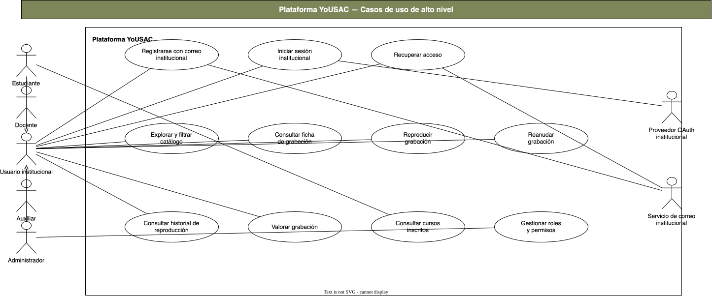](referencias/casos-de-uso/01-alto-nivel.drawio) | Alto nivel | Presenta la meta global del sistema (`CU-01`) y todos los actores. |
| [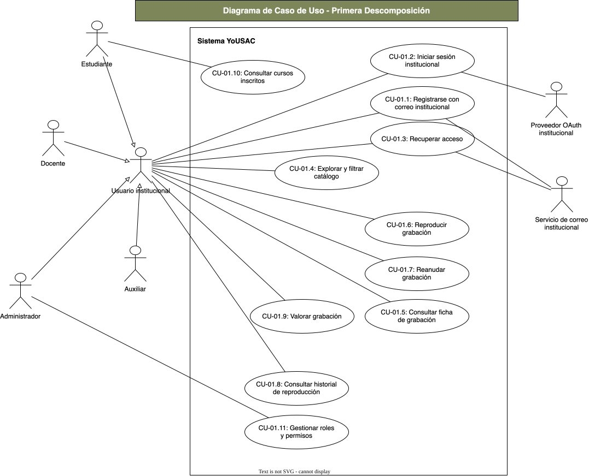](referencias/casos-de-uso/02-primera-descomposicion.drawio) | Primera descomposición | Presenta los once casos de uso del alcance (`CU-01.1` a `CU-01.11`) y sus actores. |
| [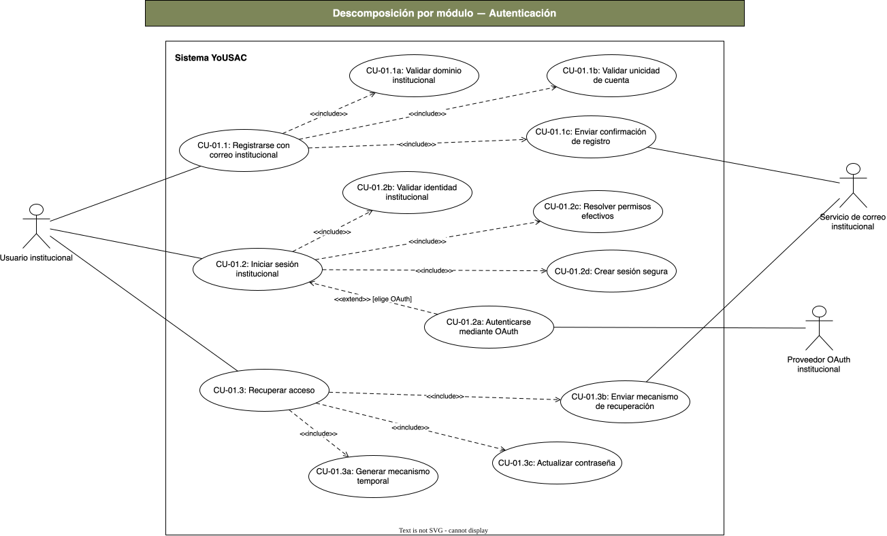](referencias/casos-de-uso/03-autenticacion.drawio) | Descomposición por módulo | Detalla registro, inicio de sesión y recuperación con sus `include`/`extend`. |
| [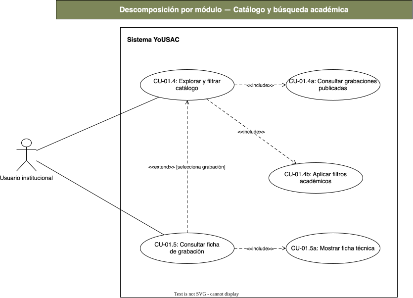](referencias/casos-de-uso/04-catalogo.drawio) | Descomposición por módulo | Detalla exploración, filtros y ficha con sus `include`/`extend`. |
| [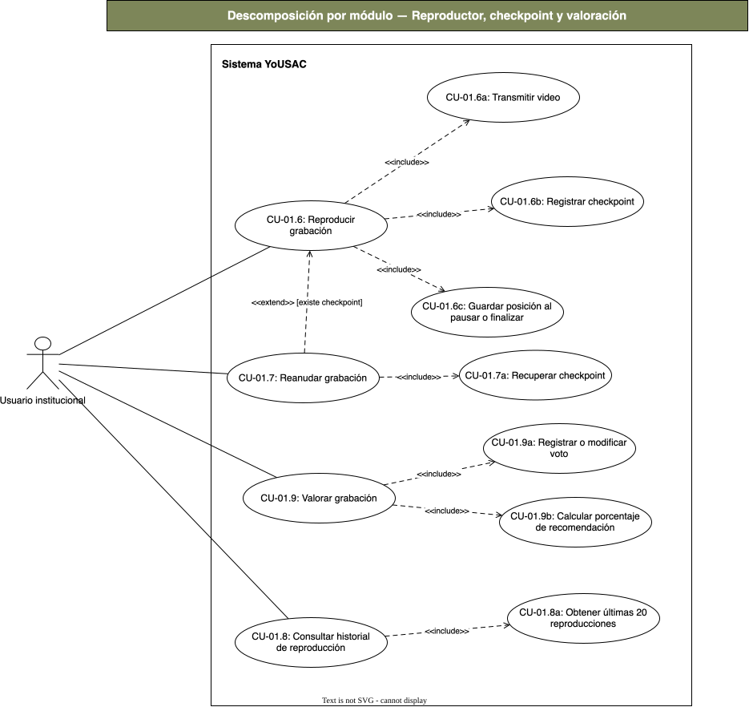](referencias/casos-de-uso/05-reproduccion.drawio) | Descomposición por módulo | Detalla streaming, checkpoint, reanudación, historial y valoración con sus `include`/`extend`. |
| [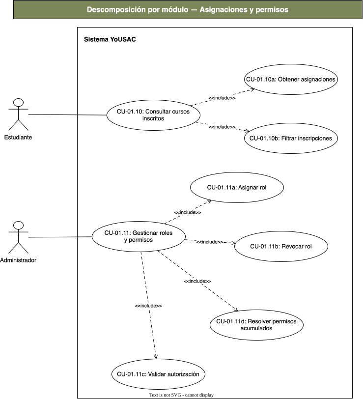](referencias/casos-de-uso/06-asignaciones-permisos.drawio) | Descomposición por módulo | Detalla consulta de cursos y gestión RBAC con sus `include`. |
| [Diagramas locales 07 a 17](referencias/casos-de-uso-locales/) | Casos de uso locales | Un diagrama reducido por cada caso expandido, con sus relaciones inmediatas. |

---

## CU-01.1 — Registrarse con correo institucional

| Campo | Definición |
|---|---|
| Objetivo | Crear una cuenta YoUSAC válida con un correo de la Facultad de Ingeniería. |
| Actor principal | Usuario institucional. |
| Actor secundario | Servicio de correo institucional. |
| Disparador | La persona selecciona registrarse. |
| Precondición | No existe una cuenta registrada con el correo proporcionado. |
| Postcondición de éxito | La cuenta queda creada y se solicita confirmación por correo. |

**Flujo principal**

1. El usuario solicita crear una cuenta e ingresa los datos obligatorios.
2. El sistema valida que el correo pertenezca a `@ingenieria.usac.edu.gt` o `@ing.usac.edu.gt`.
3. El sistema valida que el correo no esté registrado.
4. El sistema crea la cuenta.
5. El sistema solicita al Servicio de correo institucional el envío de la confirmación.
6. El sistema informa que el registro fue completado.

**Alternativos y excepciones**

- A1. Si el correo no pertenece a un dominio permitido, el sistema rechaza el registro y solicita un correo institucional válido.
- A2. Si el correo ya está registrado, el sistema informa la situación y ofrece el flujo `CU-01.3 — Recuperar acceso`.
- E1. Si falla el envío de la confirmación, la cuenta se conserva y el sistema informa que se reintentará el envío.

**Relaciones locales**: `CU-01.1 — Registrarse` incluye `CU-01.1a — Validar dominio institucional`, `CU-01.1b — Validar unicidad de cuenta` y `CU-01.1c — Enviar confirmación de registro`.

[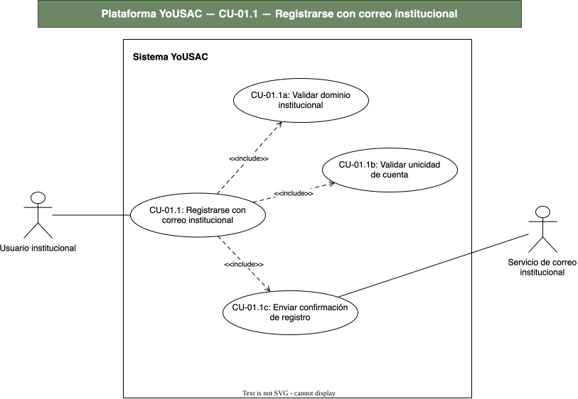](referencias/casos-de-uso-locales/07-cu-01-1-registro.drawio)

## CU-01.2 — Iniciar sesión institucional

| Campo | Definición |
|---|---|
| Objetivo | Obtener una sesión segura para acceder a las capacidades autorizadas de YoUSAC. |
| Actor principal | Usuario institucional. |
| Actor secundario | Proveedor OAuth institucional, cuando se usa acceso delegado. |
| Disparador | El usuario solicita iniciar sesión. |
| Precondición | La cuenta está registrada y habilitada. |
| Postcondición de éxito | Existe una sesión web segura con los permisos acumulados de la cuenta. |

**Flujo principal**

1. El usuario introduce su correo institucional y credenciales.
2. El sistema valida el dominio institucional y las credenciales.
3. El sistema obtiene los roles asociados con la cuenta y calcula sus permisos efectivos.
4. El sistema crea la sesión segura.
5. El sistema concede acceso a YoUSAC.

**Alternativos y excepciones**

- A1. Si el usuario elige OAuth, YoUSAC redirige al Proveedor OAuth institucional; tras una autorización válida, continúa en el paso 3.
- E1. Si las credenciales son inválidas o la cuenta está inhabilitada, el sistema niega el acceso sin crear sesión.
- E2. Si el Proveedor OAuth rechaza o cancela la autorización, el sistema muestra el acceso como no completado.

**Relaciones locales**: `CU-01.2a — Autenticarse mediante OAuth` extiende `CU-01.2 — Iniciar sesión institucional` cuando el usuario selecciona OAuth. `CU-01.2 — Iniciar sesión institucional` incluye `CU-01.2b — Validar identidad institucional`, `CU-01.2c — Resolver permisos efectivos` y `CU-01.2d — Crear sesión segura`.

[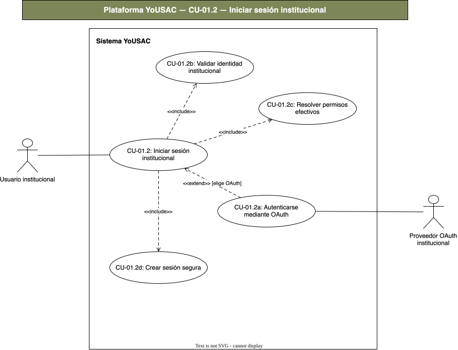](referencias/casos-de-uso-locales/08-cu-01-2-inicio-sesion.drawio)

## CU-01.3 — Recuperar acceso

| Campo | Definición |
|---|---|
| Objetivo | Restablecer el acceso de una cuenta mediante el correo institucional asociado. |
| Actor principal | Usuario institucional. |
| Actor secundario | Servicio de correo institucional. |
| Disparador | El usuario selecciona "Olvidé mi contraseña". |
| Precondición | El correo pertenece a una cuenta registrada. |
| Postcondición de éxito | La contraseña se actualiza y el usuario puede volver a iniciar sesión. |

**Flujo principal**

1. El usuario solicita recuperar acceso e indica su correo institucional.
2. El sistema identifica la cuenta y genera un mecanismo temporal de recuperación.
3. El sistema solicita al Servicio de correo institucional el envío del enlace o código.
4. El usuario presenta el mecanismo recibido e indica una nueva contraseña.
5. El sistema valida el mecanismo y actualiza la contraseña.
6. El sistema confirma el restablecimiento.

**Alternativos y excepciones**

- A1. Si el correo no corresponde a una cuenta, el sistema informa que no puede iniciar la recuperación.
- E1. Si el mecanismo es inválido o venció, el sistema solicita iniciar una nueva recuperación.
- E2. Si el correo no puede entregarse, el sistema informa el fallo y permite solicitar un nuevo envío.

**Relaciones locales**: `CU-01.3 — Recuperar acceso` incluye `CU-01.3a — Generar mecanismo temporal`, `CU-01.3b — Enviar mecanismo de recuperación` y `CU-01.3c — Actualizar contraseña`.

[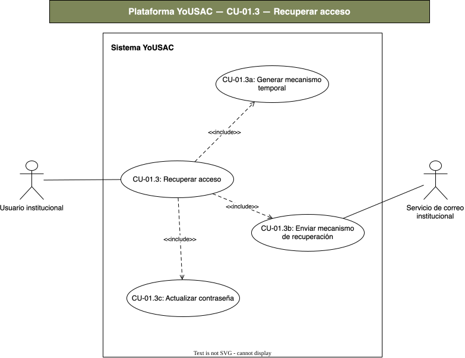](referencias/casos-de-uso-locales/09-cu-01-3-recuperar-acceso.drawio)

### Implementación P4 relacionada

- El mecanismo temporal es un enlace único con token aleatorio almacenado como hash y expiración de 30 minutos.
- `RF-004` se implementa mediante preferencias `new_recording` y `admin_notice`; recuperación y seguridad permanecen obligatorias.
- `RF-005` cubre el restablecimiento de contraseña y cambios administrativos de roles.
- `RF-027` a `RF-029` se entregan por la cola PostgreSQL y el worker de correo del microservicio de Notificaciones.

## CU-01.4 — Explorar y filtrar catálogo

| Campo | Definición |
|---|---|
| Objetivo | Encontrar grabaciones académicas publicadas según criterios de interés. |
| Actor principal | Usuario institucional. |
| Disparador | El usuario accede al catálogo o ejecuta una búsqueda. |
| Precondición | El usuario tiene una sesión válida. |
| Postcondición de éxito | El sistema presenta las grabaciones públicas que cumplen los criterios seleccionados. |

**Flujo principal**

1. El usuario abre el catálogo.
2. El sistema muestra las grabaciones publicadas disponibles.
3. El usuario puede indicar uno o más filtros: semestre/año, escuela/área, curso, catedrático o tema/etiqueta.
4. El sistema valida y aplica los criterios.
5. El sistema muestra los resultados coincidentes.

**Alternativos y excepciones**

- A1. Si el usuario no aplica filtros, el sistema conserva la vista general del catálogo.
- A2. Si la búsqueda no obtiene resultados, el sistema informa la ausencia de coincidencias y mantiene disponibles los filtros.
- E1. Si un criterio es inválido, el sistema lo señala y no ejecuta ese filtro.

**Relaciones locales**: `CU-01.4 — Explorar y filtrar catálogo` incluye `CU-01.4a — Consultar grabaciones publicadas` y `CU-01.4b — Aplicar filtros académicos`.

[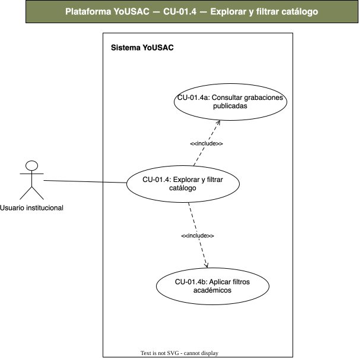](referencias/casos-de-uso-locales/10-cu-01-4-explorar-catalogo.drawio)

## CU-01.5 — Consultar ficha de grabación

| Campo | Definición |
|---|---|
| Objetivo | Conocer la información académica de una grabación antes de reproducirla. |
| Actor principal | Usuario institucional. |
| Disparador | El usuario selecciona una grabación desde el catálogo. |
| Precondición | La grabación está publicada y visible en el catálogo. |
| Postcondición de éxito | El usuario visualiza la ficha técnica de la grabación seleccionada. |

**Flujo principal**

1. El usuario selecciona una grabación del catálogo.
2. El sistema localiza la grabación publicada.
3. El sistema muestra la ficha: curso, unidad, fecha de impartición, docentes y auxiliares participantes, sílabo o material adjunto cuando exista.
4. El usuario puede decidir reproducir la grabación.

**Alternativos y excepciones**

- A1. Si la grabación no tiene sílabo o material adjunto, el sistema muestra la ficha sin ese elemento.
- E1. Si la grabación dejó de estar publicada, el sistema informa que ya no está disponible y retorna al catálogo.

**Relaciones locales**: `CU-01.5 — Consultar ficha de grabación` extiende `CU-01.4 — Explorar y filtrar catálogo` cuando el usuario selecciona una grabación; incluye `CU-01.5a — Mostrar ficha técnica`.

### Implementación P5 relacionada

La ficha se obtiene mediante `GET /api/catalog/:id`, con JWT validado por el Gateway y consulta gRPC a Catálogo. La respuesta incluye `lecture_date`, `unit`, etiquetas normalizadas, docentes, auxiliares y adjuntos. Cuando una grabación no tiene materiales, la interfaz muestra la ficha sin enlaces adicionales; el CSV acepta `topics` separado por `;` y `attachments_json` opcional.

[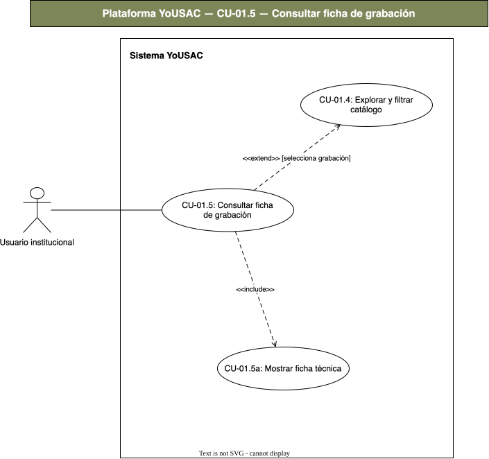](referencias/casos-de-uso-locales/11-cu-01-5-ficha-grabacion.drawio)

## CU-01.6 — Reproducir grabación

| Campo | Definición |
|---|---|
| Objetivo | Visualizar mediante streaming una grabación académica publicada. |
| Actor principal | Usuario institucional. |
| Disparador | El usuario selecciona reproducir una grabación. |
| Precondición | Existe una sesión válida y la grabación está publicada. |
| Postcondición de éxito | La reproducción termina o queda disponible para continuar desde el progreso almacenado. |

**Flujo principal**

1. El usuario solicita reproducir una grabación.
2. El sistema verifica que está publicada y autoriza el acceso.
3. El sistema inicia el streaming de video.
4. Mientras el usuario reproduce el contenido, el sistema guarda su progreso cada 10 segundos.
5. Si el usuario pausa o finaliza, el sistema guarda la posición exacta.

**Alternativos y excepciones**

- A1. Si existe un checkpoint previo, se aplica `CU-01.7 — Reanudar grabación` antes de iniciar el streaming.
- E1. Si el video no está disponible, el sistema informa el error y no inicia la reproducción.
- E2. Si no se puede persistir un checkpoint, el sistema conserva la reproducción activa e informa que el progreso no fue guardado.

**Relaciones locales**: `CU-01.6 — Reproducir grabación` incluye `CU-01.6a — Transmitir video`, `CU-01.6b — Registrar checkpoint` y `CU-01.6c — Guardar posición al pausar o finalizar`. `CU-01.7 — Reanudar grabación` lo extiende cuando existe un checkpoint.

[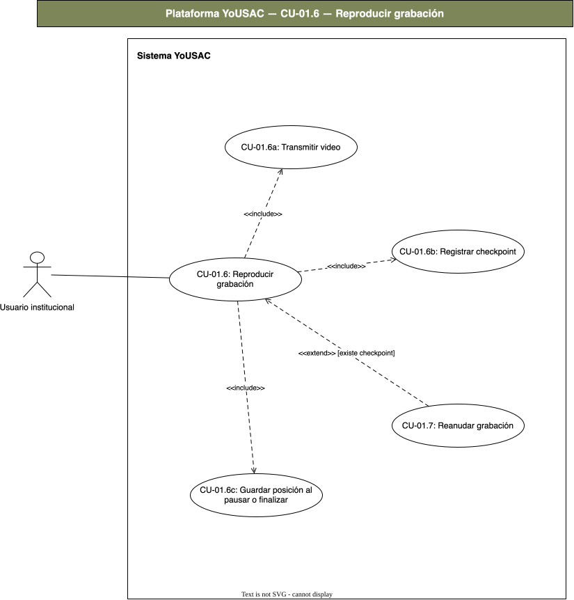](referencias/casos-de-uso-locales/12-cu-01-6-reproducir.drawio)

## CU-01.7 — Reanudar grabación

| Campo | Definición |
|---|---|
| Objetivo | Continuar una grabación en la posición exacta almacenada para el usuario. |
| Actor principal | Usuario institucional. |
| Disparador | El usuario elige continuar una grabación con progreso guardado. |
| Precondición | Existe un checkpoint de la grabación para la cuenta actual. |
| Postcondición de éxito | El streaming inicia desde el segundo o minuto exacto registrado. |

**Flujo principal**

1. El usuario solicita continuar una grabación.
2. El sistema recupera el checkpoint asociado al usuario y la grabación.
3. El sistema inicia la transmisión desde la posición recuperada.
4. El sistema continúa el registro periódico de progreso.

**Alternativos y excepciones**

- A1. Si no hay checkpoint, el sistema ofrece comenzar desde el inicio.
- E1. Si el checkpoint es inválido para la duración actual del video, el sistema inicia desde el principio e informa el ajuste.

**Relaciones locales**: `CU-01.7 — Reanudar grabación` extiende `CU-01.6 — Reproducir grabación` bajo la condición `[existe checkpoint]`; incluye `CU-01.7a — Recuperar checkpoint`.

[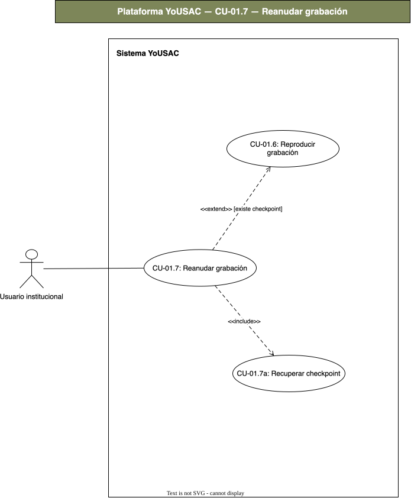](referencias/casos-de-uso-locales/13-cu-01-7-reanudar.drawio)

## CU-01.8 — Consultar historial de reproducción

| Campo | Definición |
|---|---|
| Objetivo | Revisar las veinte clases que el usuario reprodujo más recientemente. |
| Actor principal | Usuario institucional. |
| Disparador | El usuario abre su historial. |
| Precondición | El usuario tiene una sesión válida. |
| Postcondición de éxito | El sistema presenta hasta veinte grabaciones en orden de reproducción más reciente. |

**Flujo principal**

1. El usuario solicita consultar el historial.
2. El sistema identifica las últimas veinte grabaciones reproducidas por la cuenta.
3. El sistema las ordena de la más reciente a la menos reciente.
4. El sistema muestra el historial y el progreso disponible de cada grabación.

**Alternativos y excepciones**

- A1. Si el usuario aún no ha reproducido grabaciones, el sistema muestra un historial vacío.
- E1. Si no se puede obtener el historial, el sistema informa que no está disponible temporalmente.

**Relaciones locales**: `CU-01.8 — Consultar historial de reproducción` incluye `CU-01.8a — Obtener últimas 20 reproducciones`.

[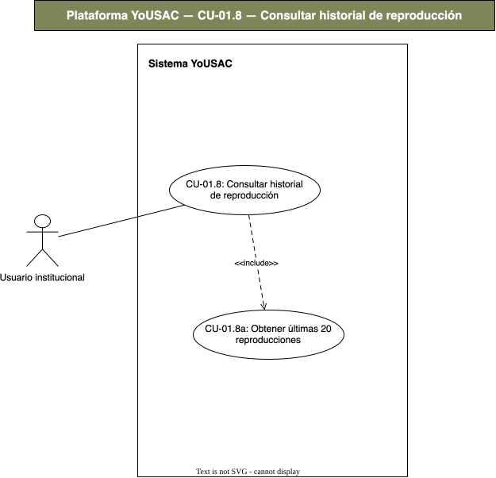](referencias/casos-de-uso-locales/14-cu-01-8-historial.drawio)

## CU-01.9 — Valorar grabación

| Campo | Definición |
|---|---|
| Objetivo | Emitir o modificar un voto positivo o negativo sobre una grabación y conocer su recomendación. |
| Actor principal | Usuario institucional. |
| Disparador | El usuario selecciona una valoración en una grabación. |
| Precondición | Existe una sesión válida y la grabación está publicada. |
| Postcondición de éxito | El voto único del usuario queda registrado o modificado y el porcentaje de recomendación queda actualizado. |

**Flujo principal**

1. El usuario selecciona voto positivo o negativo.
2. El sistema verifica si existe un voto previo de esa cuenta para la grabación.
3. El sistema registra el voto o reemplaza el voto previo.
4. El sistema calcula el porcentaje de recomendación como votos positivos entre votos totales.
5. El sistema muestra la valoración actualizada.

**Alternativos y excepciones**

- A1. Si el voto coincide con el ya registrado, el sistema conserva la valoración e informa que no hubo cambio.
- E1. Si no puede actualizarse la valoración, el sistema conserva el valor anterior e informa el fallo.

**Relaciones locales**: `CU-01.9 — Valorar grabación` incluye `CU-01.9a — Registrar o modificar voto` y `CU-01.9b — Calcular porcentaje de recomendación`.

[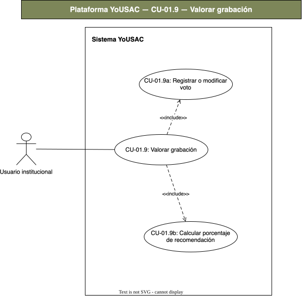](referencias/casos-de-uso-locales/15-cu-01-9-valorar.drawio)

## CU-01.10 — Consultar cursos inscritos

| Campo | Definición |
|---|---|
| Objetivo | Consultar los cursos inscritos y sus datos académicos. |
| Actor principal | Estudiante. |
| Disparador | El estudiante abre su panel de asignaciones. |
| Precondición | El estudiante tiene una sesión válida. |
| Postcondición de éxito | El sistema muestra los cursos inscritos que cumplen los filtros aplicados. |

**Flujo principal**

1. El estudiante solicita sus cursos inscritos.
2. El sistema obtiene las asignaciones de la cuenta.
3. El sistema presenta los cursos con semestre, estado y credenciales académicas.
4. El estudiante puede filtrar por semestre, estado o credenciales.
5. El sistema actualiza la lista con los criterios seleccionados.

**Alternativos y excepciones**

- A1. Si no existen inscripciones para los criterios seleccionados, el sistema muestra una lista vacía.
- E1. Si la cuenta no tiene rol de estudiante, el sistema no muestra el panel de asignaciones.

**Relaciones locales**: `CU-01.10 — Consultar cursos inscritos` incluye `CU-01.10a — Obtener asignaciones` y `CU-01.10b — Filtrar inscripciones`.

[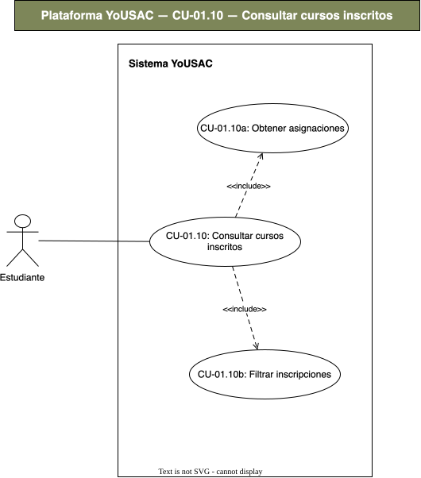](referencias/casos-de-uso-locales/16-cu-01-10-cursos-inscritos.drawio)

## CU-01.11 — Gestionar roles y permisos

| Campo | Definición |
|---|---|
| Objetivo | Asignar o revocar roles de una cuenta y aplicar los permisos resultantes. |
| Actor principal | Administrador. |
| Disparador | El administrador abre la gestión de una cuenta. |
| Precondición | El administrador tiene una sesión válida y permiso de administración de roles. |
| Postcondición de éxito | Los roles de la cuenta quedan actualizados y sus permisos efectivos reflejan la unión de los roles asignados. |

**Flujo principal**

1. El administrador busca y selecciona una cuenta.
2. El sistema muestra los roles actuales de la cuenta.
3. El administrador asigna o revoca uno o más roles.
4. El sistema valida la autorización del administrador y las reglas de asignación.
5. El sistema actualiza los roles de la cuenta.
6. El sistema recalcula los permisos efectivos sin exigir cambio de perfil.
7. El sistema confirma la actualización.

**Alternativos y excepciones**

- A1. Si no se modifican roles, el sistema conserva la configuración actual.
- E1. Si el administrador no cuenta con autorización, el sistema rechaza la operación.
- E2. Si la cuenta no existe o no está disponible, el sistema informa el error y no cambia roles.

**Relaciones locales**: `CU-01.11 — Gestionar roles y permisos` incluye `CU-01.11a — Asignar rol`, `CU-01.11b — Revocar rol`, `CU-01.11c — Validar autorización` y `CU-01.11d — Resolver permisos acumulados`.

[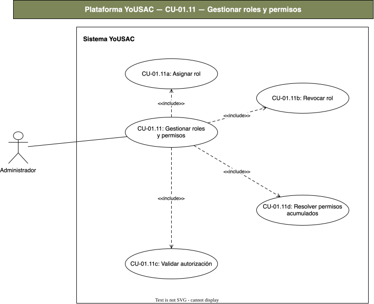](referencias/casos-de-uso-locales/17-cu-01-11-roles-permisos.drawio)
