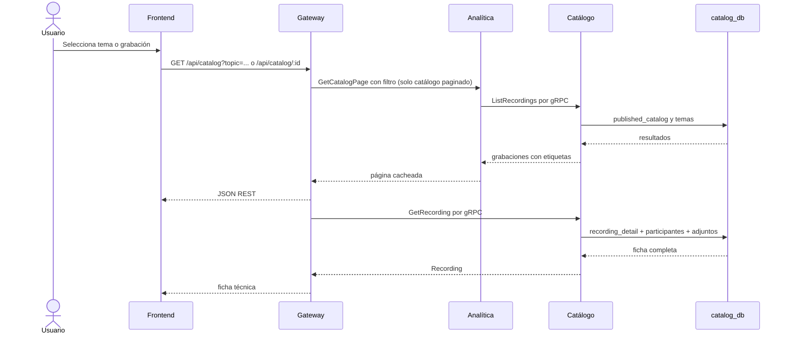

# Implementación P5 — Ficha detallada y modelo académico

## Alcance

P5 completa RF-009 y RF-010 en el microservicio de Catálogo. La plataforma ahora modela temas múltiples, muestra la ficha técnica de una grabación y separa los participantes entre docentes y auxiliares.

Los materiales se almacenan como metadatos y URL/ruta. No se implementa carga binaria ni integración con Google Cloud Storage; esas capacidades pertenecen al pendiente P1.

## Modelo de datos

Catálogo mantiene PostgreSQL como dueño de las entidades académicas:

- `topics` contiene etiquetas normalizadas con índice único insensible a mayúsculas.
- `recording_topics` relaciona grabaciones y etiquetas mediante una relación muchos-a-muchos.
- `recording_professors` conserva los participantes y distingue `professor` de `assistant` mediante `role_type`.
- `attachments` almacena `filename`, `file_path`, `file_type` y `attachment_type` (`syllabus` o `material`).
- `recordings.topic` se conserva para compatibilidad con importaciones anteriores.

La migración [`databases/catalog/06-p5.sql`](../databases/catalog/06-p5.sql) es idempotente y redefine `published_catalog`, `recording_detail` y `sp_import_recordings_csv`.

## Importación CSV

Las columnas actuales continúan siendo válidas. P5 agrega dos columnas opcionales:

```text
topics,attachments_json
```

`topics` usa etiquetas separadas por punto y coma:

```text
gRPC;Microservicios;Arquitectura
```

`attachments_json` usa un arreglo JSON dentro de una celda CSV entrecomillada:

```json
[{"filename":"silabo.pdf","file_path":"https://ejemplo.edu/silabo.pdf","file_type":"application/pdf","attachment_type":"syllabus"}]
```

El Gateway no procesa estos datos directamente. Catálogo valida el CSV, ejecuta el procedimiento almacenado dentro de una transacción y reemplaza las relaciones de participantes, temas y adjuntos de cada grabación importada.

## Contratos y flujo

`proto/catalog.proto` expone:

- `ListTopics` para alimentar los filtros del catálogo.
- El campo `topic` en `ListRequest`.
- `topics`, `professors`, `assistants` y `attachments` en `Recording`.

El flujo de consulta es:



La consulta de detalle no accede a bases de otros servicios. El Gateway mantiene la validación JWT y adapta los nombres protobuf a la respuesta REST estable.

## Interfaz

`/catalogo` ofrece un filtro específico de temas y conserva la búsqueda, filtros académicos y paginación existentes. `/reproductor/[id]` muestra:

- curso, semestre, unidad y fecha;
- etiquetas académicas;
- docentes y auxiliares en listas separadas;
- el sílabo y los materiales como enlaces;
- un estado vacío cuando no existen adjuntos.

## Pruebas

La cobertura P5 incluye:

- normalización y asociación de múltiples temas;
- filtrado por tema y combinación con filtros existentes;
- compatibilidad con el CSV anterior;
- validación de rutas, tipos y clases de adjuntos;
- ficha con y sin materiales;
- separación de docentes y auxiliares;
- adaptación Gateway/gRPC;
- renderizado del catálogo y la ficha.

La marca de P5 en `context/pendientes-fase1.md` se agrega únicamente después de ejecutar la suite automatizada, los contratos, Docker y la verificación funcional en navegador.
