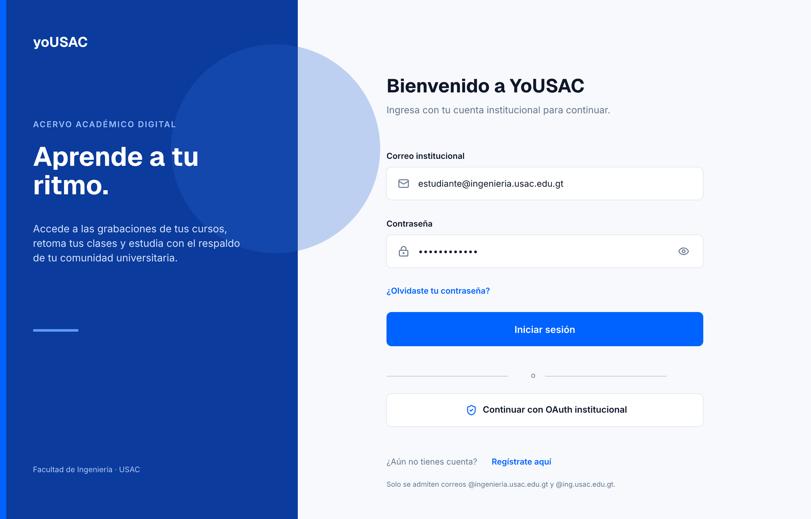
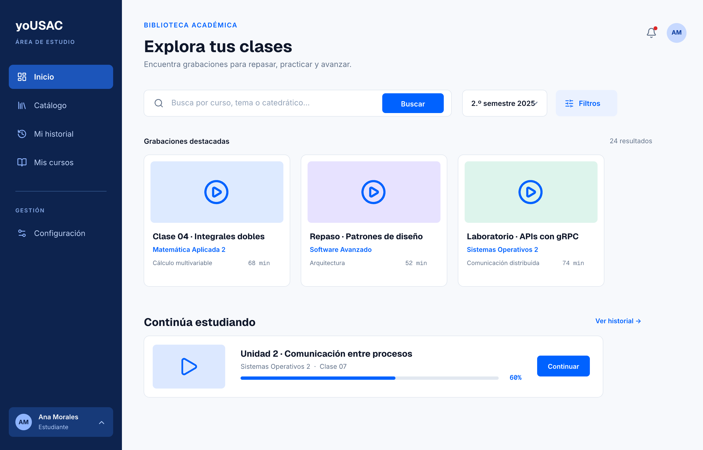
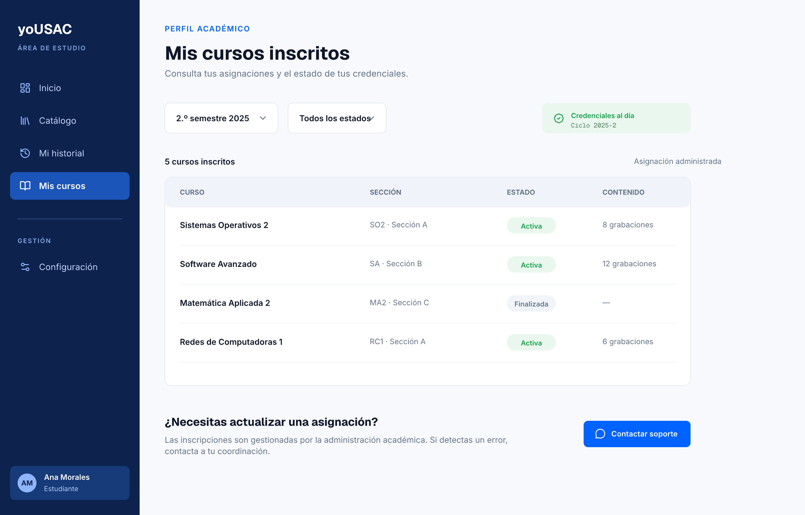
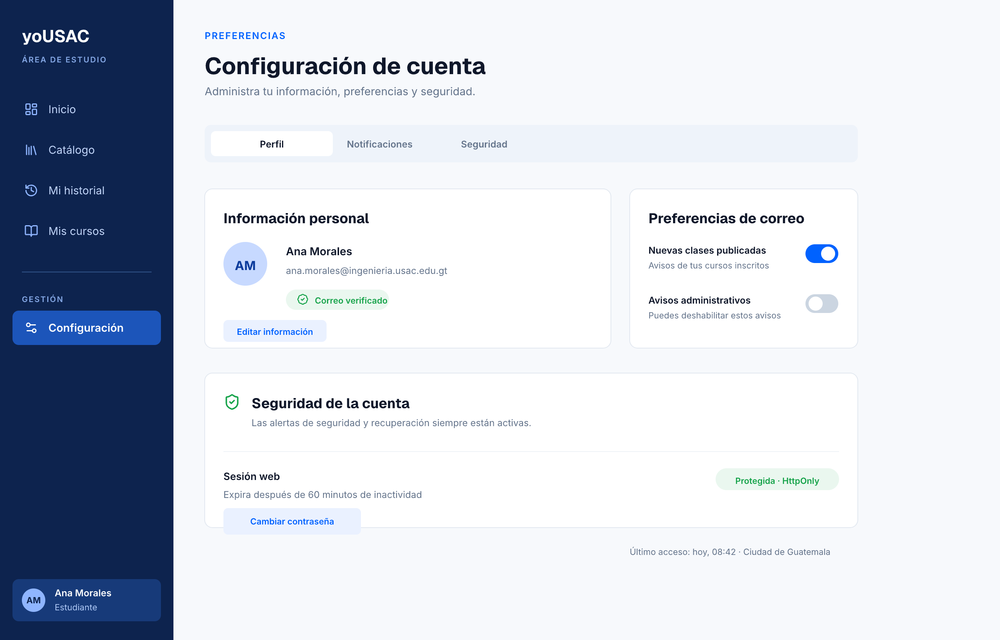
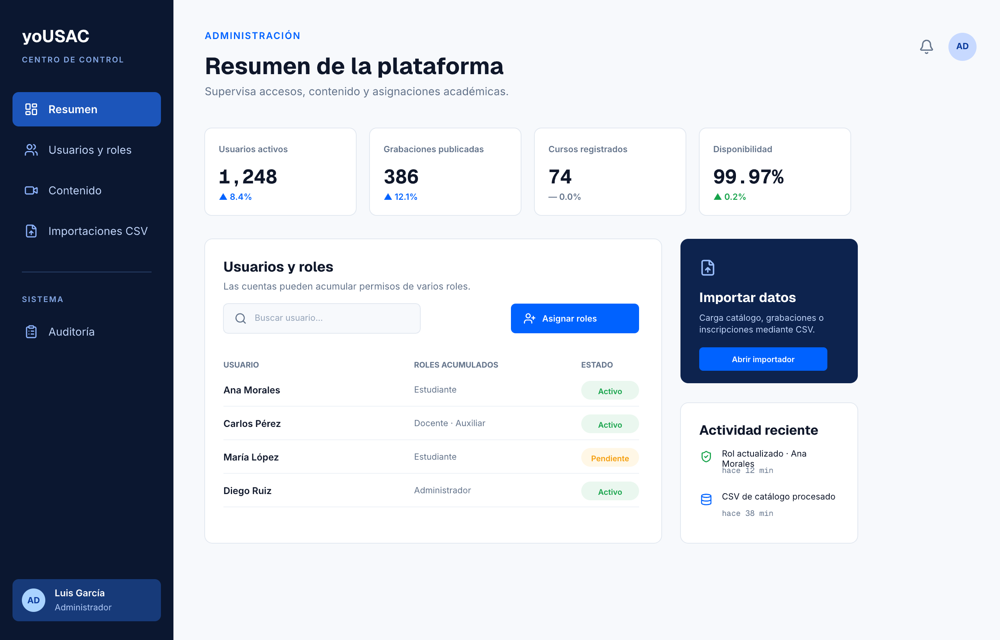

# Mockups UI/UX — YoUSAC

La galería editable de la Práctica 1 fue elaborada y contiene seis pantallas de escritorio organizadas como frames independientes:

## Galería exportada

| Pantalla | Mockup |
|---|---|
| Login institucional |  |
| Catálogo académico |  |
| Reproductor y checkpoint |  |
| Asignaciones y permisos |  |
| Configuración de cuenta |  |
| Panel administrador |  |

1. **Login institucional:** validación visual del correo permitido y acceso mediante credenciales u OAuth institucional.
2. **Catálogo académico:** búsqueda, filtros por semestre, tarjetas de grabaciones y continuidad del historial.
3. **Reproductor y checkpoint:** streaming, progreso exacto, guardado periódico, ficha de grabación y valoración binaria.
4. **Asignaciones y permisos:** cursos inscritos filtrables por semestre/estado, credenciales académicas y soporte administrado.
5. **Configuración de cuenta:** perfil, preferencias de correo y seguridad de sesión; las alertas de seguridad permanecen obligatorias.
6. **Panel administrador:** indicadores, gestión acumulativa de roles, importaciones CSV y actividad de auditoría.

## Criterios visuales

- Identidad basada en azul institucional, superficies claras, contraste alto y navegación lateral consistente.
- Tipografías `Geist` para títulos e `Inter` para contenido; `Geist Mono` para métricas, tiempos y porcentajes.
- El flujo de inscripción no se presenta como autoservicio: la pantalla comunica que las asignaciones son administradas por coordinación.
- Los estados importantes son explícitos: progreso, checkpoint guardado, credenciales al día, sesión protegida y permisos acumulados.
