# Práctica 1: Planteamiento y diseño

## Plataforma YoUSAC

**Curso:** Software Avanzado
**Estudiante:** Abdiel Otzoy
**Carnet:** 202300350
**Versión:** 0.1.0

## Índice

- [1. Introducción](#1-introducción)
- [2. Descripción del problema y alcance](#2-descripción-del-problema-y-alcance)
- [3. Requerimientos del sistema](#3-requerimientos-del-sistema)
  - [3.1 Requerimientos funcionales](#31-requerimientos-funcionales)
  - [3.2 Requerimientos no funcionales](#32-requerimientos-no-funcionales)
- [4. Modelo de casos de uso UML](#4-modelo-de-casos-de-uso-uml)
  - [4.1 Diagrama de alto nivel](#41-diagrama-de-alto-nivel)
  - [4.2 Primera descomposición](#42-primera-descomposición)
  - [4.3 Casos de uso expandidos](#43-casos-de-uso-expandidos)
- [5. Vista de arquitectura 4+1](#5-vista-de-arquitectura-41)
  - [5.1 Vista lógica](#51-vista-lógica)
  - [5.2 Vista de procesos](#52-vista-de-procesos)
  - [5.3 Vista de componentes](#53-vista-de-componentes)
  - [5.4 Vista física o de despliegue](#54-vista-física-o-de-despliegue)
  - [5.5 Vista de escenarios](#55-vista-de-escenarios)
- [6. Diseño del modelo de datos](#6-diseño-del-modelo-de-datos)
  - [6.1 Persistencia por microservicio](#61-persistencia-por-microservicio)
  - [6.2 Lógica programable](#62-lógica-programable)
- [7. Diseño UI/UX](#7-diseño-uiux)
- [8. Archivos fuente de la documentación](#8-archivos-fuente-de-la-documentación)
- [9. Integración y control de versiones](#9-integración-y-control-de-versiones)
- [10. Conclusiones](#10-conclusiones)

## 1. Introducción

YoUSAC es una plataforma web universitaria de video bajo demanda (VOD) para que estudiantes y docentes de la Facultad de Ingeniería puedan consultar grabaciones de clases, buscar contenido académico, reproducir videos y continuar su avance desde el último punto guardado.

La Práctica 1 define la base de análisis y diseño de la plataforma. El trabajo comprende los requerimientos funcionales y no funcionales, el modelo de casos de uso, la arquitectura basada en el modelo 4+1 de Kruchten, el diseño de persistencia políglota y los mockups principales de la interfaz web.

La solución se plantea como una arquitectura de microservicios políglota. TypeScript se utiliza para el Gateway, Identidad, Catálogo y Notificaciones; Go para Reproducción; y Python para Analítica. El Gateway expone REST/JSON hacia el cliente y los microservicios se comunican internamente mediante gRPC sobre HTTP/2 con contratos Protocol Buffers.

## 2. Descripción del problema y alcance

La institución necesita centralizar el acceso al acervo académico digital y permitir que los usuarios autorizados encuentren y aprovechen las grabaciones de clases impartidas en semestres anteriores.

El alcance de esta primera versión contempla los siguientes módulos:

| Módulo | Capacidades principales |
|---|---|
| Autenticación institucional | Registro, inicio de sesión, recuperación de acceso y OAuth institucional para correos permitidos. |
| Catálogo académico | Exploración y filtrado por semestre, año, escuela, curso, catedrático y tema. |
| Reproducción | Streaming, checkpoint de avance, reanudación, historial y valoración de grabaciones. |
| Asignaciones y permisos | Consulta de cursos inscritos y autorización basada en roles acumulativos (RBAC). |
| Analítica | Tendencias, ranking, visualizaciones semanales y recomendaciones personalizadas. |
| Notificaciones | Confirmaciones, avisos administrativos, eventos de seguridad y notificaciones de nuevas clases. |

Las decisiones funcionales y no funcionales utilizadas como base se reflejan en los requerimientos y modelos documentados en este repositorio.

## 3. Requerimientos del sistema

### 3.1 Requerimientos funcionales

Los requerimientos funcionales se identifican desde `RF-001` hasta `RF-029` y se organizan en autenticación, roles e inscripciones, catálogo, reproducción, valoraciones, analítica, carga CSV y notificaciones.

Entre las funciones principales se encuentran:

- Validar el correo institucional y autenticar mediante credenciales u OAuth.
- Acumular los permisos de todos los roles asignados a una cuenta.
- Consultar y filtrar grabaciones publicadas mediante atributos académicos.
- Guardar el progreso de reproducción cada 10 segundos y al pausar o finalizar.
- Mostrar las 20 clases reproducidas más recientemente.
- Registrar un voto positivo o negativo por usuario y calcular el porcentaje de recomendación.
- Generar tendencias, rankings y recomendaciones a partir de inscripciones, historial y valoraciones.
- Importar datos de catálogo, grabaciones e inscripciones mediante archivos CSV.
- Gestionar notificaciones institucionales y preferencias de correo.

El listado completo, numerado y priorizado está disponible en [Requerimientos funcionales](requerimientos/funcionales.md).

### 3.2 Requerimientos no funcionales

Los principales atributos de calidad definidos para la solución son:

| Categoría | Criterio definido |
|---|---|
| Capacidad | Soportar al menos 500 usuarios concurrentes. |
| Rendimiento | Completar al menos el 95 % de las solicitudes normales en un máximo de 3 segundos bajo esa carga. |
| Disponibilidad | Alcanzar una disponibilidad mensual mínima del 99 % en nube. |
| Seguridad | Sesiones con expiración por inactividad, cookies `HttpOnly` y `Secure`, hash de contraseñas, JWT y secretos mediante `.env`. |
| Arquitectura | Gateway más cinco microservicios con distribución TypeScript, Go y Python. |
| Persistencia | Aplicar `Database per Microservice` con PostgreSQL, MongoDB y Redis. |
| Comunicación | Usar gRPC sobre HTTP/2 y Protocol Buffers para la comunicación interna. |
| Datos | Utilizar procedimientos almacenados, vistas, funciones y triggers donde corresponda. |
| Despliegue | Incluir Dockerfiles, Docker Compose para local y producción, CI/CD y despliegue en GCP. |

El listado completo y cuantificado se encuentra en [Requerimientos no funcionales](requerimientos/no-funcionales.md).

## 4. Modelo de casos de uso UML

El modelo identifica los actores y objetivos principales de la plataforma. Las narrativas incluyen precondiciones, flujo principal, flujos alternativos, excepciones y postcondiciones. El desarrollo detallado se encuentra en [Modelo de casos de uso UML](casos-de-uso/modelo-casos-de-uso.md).

### 4.1 Diagrama de alto nivel

El siguiente diagrama presenta la meta global del sistema (`CU-01`) y los actores que interactúan con ella.

[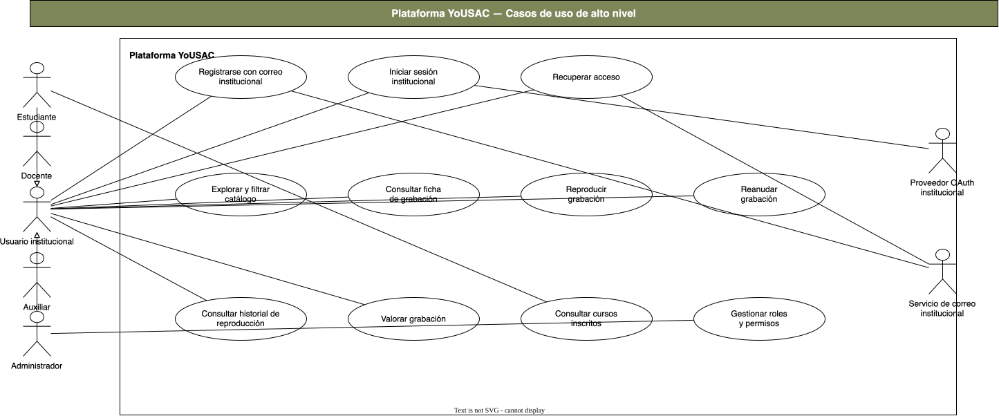](casos-de-uso/referencias/casos-de-uso/01-alto-nivel.drawio)

Actores considerados:

- Usuario institucional.
- Estudiante.
- Docente o auxiliar.
- Administrador.
- Servicio de identidad institucional.
- Servicio de correo.

### 4.2 Primera descomposición

La primera descomposición separa la meta global en los once casos de uso del alcance (`CU-01.1` a `CU-01.11`) y los relaciona con sus actores.

[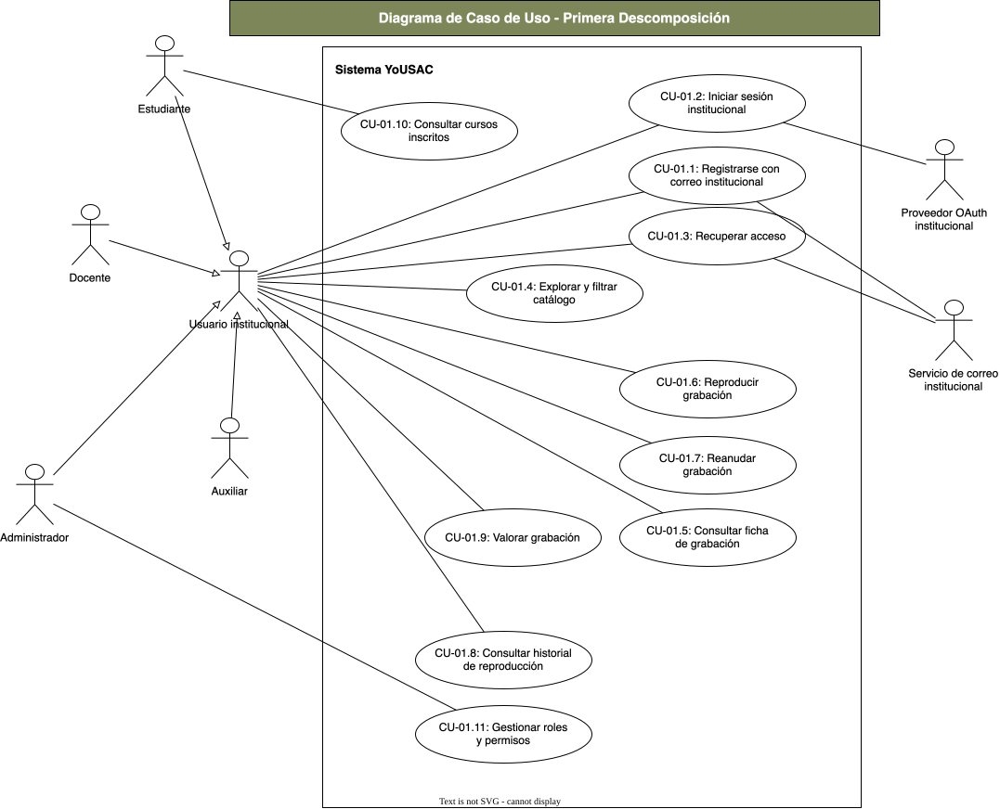](casos-de-uso/referencias/casos-de-uso/02-primera-descomposicion.drawio)

A continuación, cada módulo se detalla con relaciones `include` y `extend`, que se utilizan cuando una funcionalidad depende de otra o representa una variación del flujo principal.

#### Autenticación

[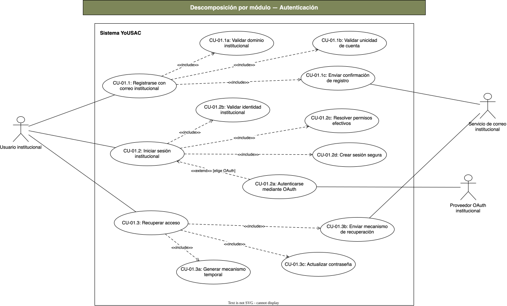](casos-de-uso/referencias/casos-de-uso/03-autenticacion.drawio)

Incluye registro institucional, inicio de sesión y recuperación de acceso.

#### Catálogo

[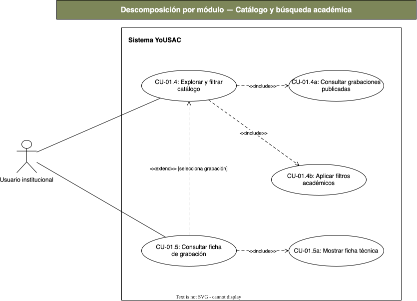](casos-de-uso/referencias/casos-de-uso/04-catalogo.drawio)

Incluye exploración, filtrado y consulta de la ficha técnica de una grabación.

#### Reproducción

[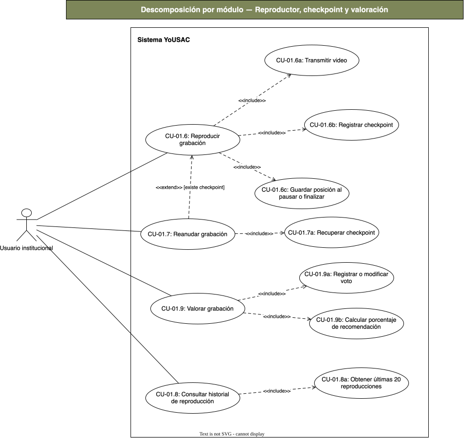](casos-de-uso/referencias/casos-de-uso/05-reproduccion.drawio)

Incluye streaming, checkpoint, reanudación, historial y valoración.

#### Asignaciones y permisos

[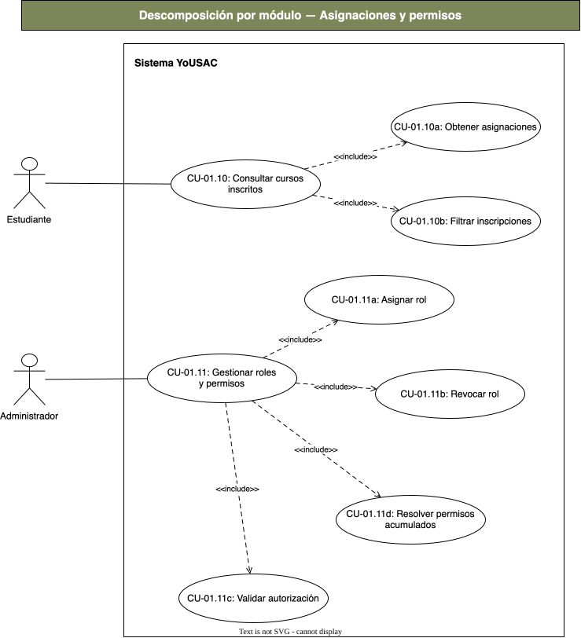](casos-de-uso/referencias/casos-de-uso/06-asignaciones-permisos.drawio)

Incluye consulta de cursos inscritos y gestión de roles y permisos.

### 4.3 Casos de uso expandidos

Cada caso de uso expandido cuenta con una narrativa y un diagrama local editable. El inventario es el siguiente:

| Código | Caso de uso | Diagrama local |
|---|---|---|
| CU-01.1 | Registrarse con correo institucional | [Diagrama](casos-de-uso/referencias/casos-de-uso-locales/07-cu-01-1-registro.drawio) |
| CU-01.2 | Iniciar sesión institucional | [Diagrama](casos-de-uso/referencias/casos-de-uso-locales/08-cu-01-2-inicio-sesion.drawio) |
| CU-01.3 | Recuperar acceso | [Diagrama](casos-de-uso/referencias/casos-de-uso-locales/09-cu-01-3-recuperar-acceso.drawio) |
| CU-01.4 | Explorar y filtrar catálogo | [Diagrama](casos-de-uso/referencias/casos-de-uso-locales/10-cu-01-4-explorar-catalogo.drawio) |
| CU-01.5 | Consultar ficha de grabación | [Diagrama](casos-de-uso/referencias/casos-de-uso-locales/11-cu-01-5-ficha-grabacion.drawio) |
| CU-01.6 | Reproducir grabación | [Diagrama](casos-de-uso/referencias/casos-de-uso-locales/12-cu-01-6-reproducir.drawio) |
| CU-01.7 | Reanudar grabación | [Diagrama](casos-de-uso/referencias/casos-de-uso-locales/13-cu-01-7-reanudar.drawio) |
| CU-01.8 | Consultar historial de reproducción | [Diagrama](casos-de-uso/referencias/casos-de-uso-locales/14-cu-01-8-historial.drawio) |
| CU-01.9 | Valorar grabación | [Diagrama](casos-de-uso/referencias/casos-de-uso-locales/15-cu-01-9-valorar.drawio) |
| CU-01.10 | Consultar cursos inscritos | [Diagrama](casos-de-uso/referencias/casos-de-uso-locales/16-cu-01-10-cursos-inscritos.drawio) |
| CU-01.11 | Gestionar roles y permisos | [Diagrama](casos-de-uso/referencias/casos-de-uso-locales/17-cu-01-11-roles-permisos.drawio) |

## 5. Vista de arquitectura 4+1

La arquitectura se documenta mediante las cinco vistas de Kruchten. El documento completo se encuentra en [Modelo de vistas 4+1](arquitectura/modelo-4-1.md).

### 5.1 Vista lógica

La vista lógica organiza las responsabilidades del sistema alrededor de los flujos del usuario institucional y del administrador. Los dominios se mantienen separados y las referencias entre ellos se realizan mediante identificadores lógicos.

[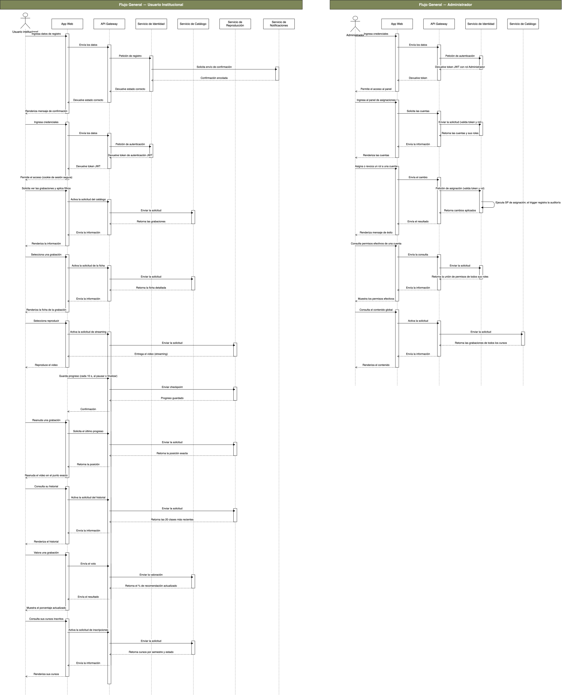](arquitectura/img/vista-logica.drawio)

### 5.2 Vista de procesos

La vista de procesos describe los flujos dinámicos de autenticación, streaming con checkpoint y valoración. El cliente se comunica con el Gateway mediante REST/JSON; la comunicación entre servicios utiliza exclusivamente gRPC sobre HTTP/2.

[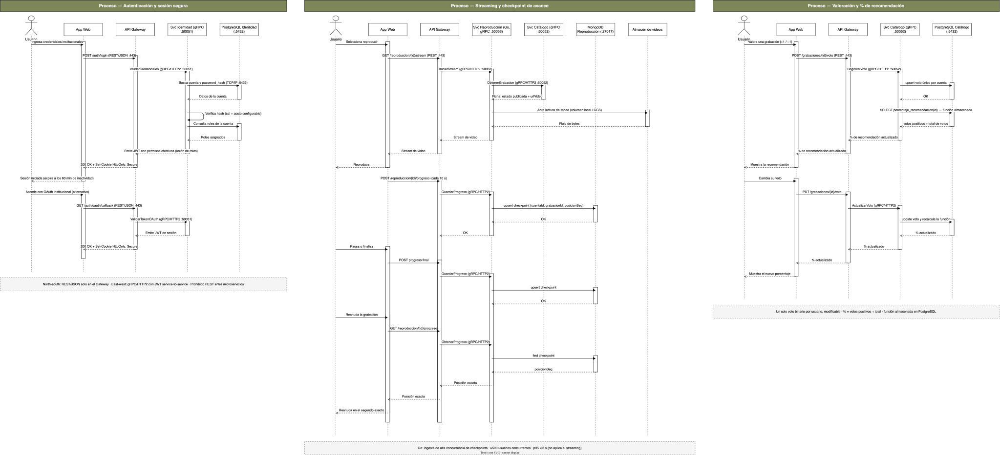](arquitectura/img/vista-procesos.drawio)

### 5.3 Vista de componentes

La solución se divide en Frontend, API Gateway, contratos Protocol Buffers, cinco microservicios, bases de datos independientes, almacenamiento de videos y componentes de seguridad y DevOps.

| Componente | Tecnología o responsabilidad |
|---|---|
| API Gateway | TypeScript, única entrada REST/JSON. |
| Identidad | TypeScript, autenticación, sesiones, roles e inscripciones. |
| Catálogo | TypeScript, cursos, grabaciones, filtros y valoraciones. |
| Reproducción | Go, streaming, checkpoints e historial. |
| Analítica | Python, tendencias, rankings y recomendaciones. |
| Notificaciones | TypeScript, cola y envío de correos. |
| Comunicación interna | gRPC/HTTP2 con Protocol Buffers y JWT. |

[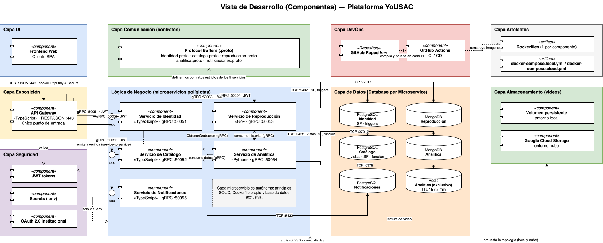](arquitectura/img/vista-componentes.drawio)

### 5.4 Vista física o de despliegue

La vista física contempla el despliegue local mediante Docker Compose y el despliegue en Google Cloud Platform. En ambos casos se mantienen el Gateway, los microservicios, las bases de datos independientes, el almacenamiento persistente de videos y la red interna de comunicación.

#### Despliegue local

[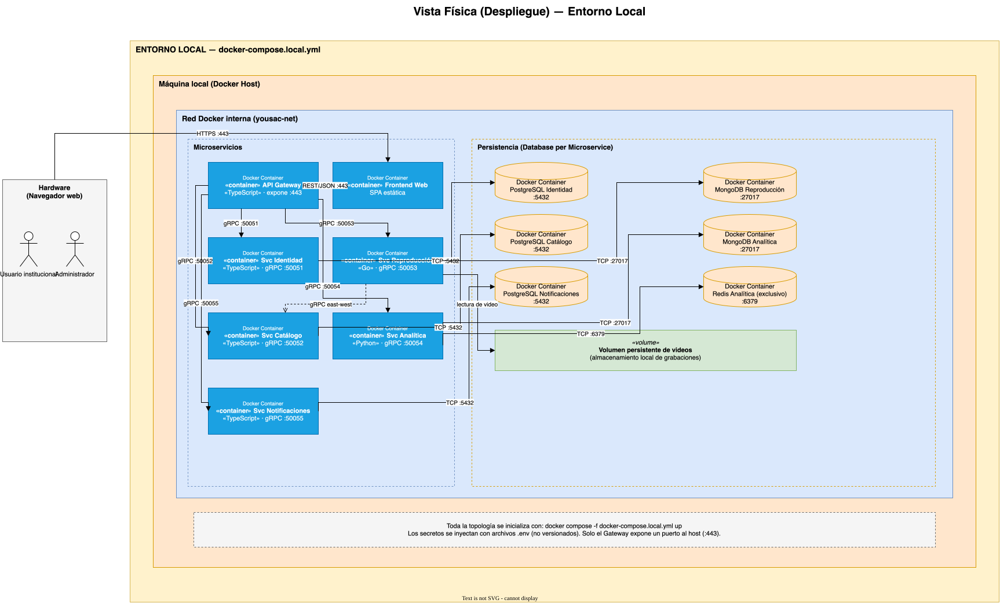](arquitectura/img/vista-despliegue-local.drawio)

#### Despliegue en nube

[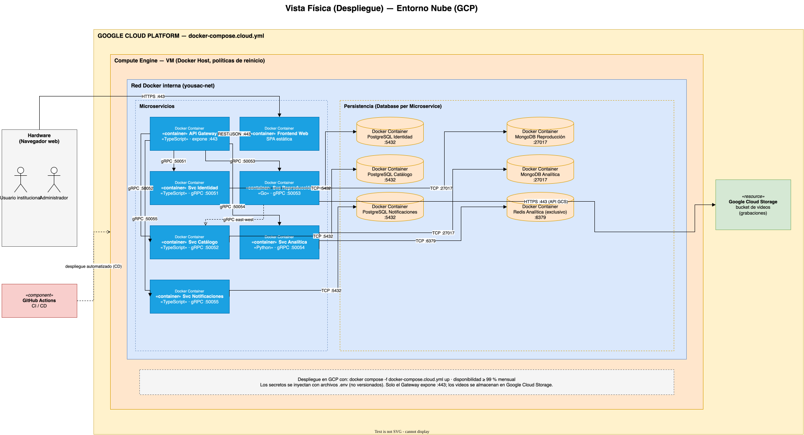](arquitectura/img/vista-despliegue-nube.drawio)

### 5.5 Vista de escenarios

La vista de escenarios conecta las demás vistas mediante los casos de uso principales. El diagrama de primera descomposición resume los objetivos que validan la arquitectura propuesta.

## 6. Diseño del modelo de datos

El diseño aplica el patrón `Database per Microservice`, evitando llaves foráneas físicas entre bases de datos de distintos servicios. El detalle completo se encuentra en [Modelo entidad-relación](base-de-datos/modelo-entidad-relacion.md).

### 6.1 Persistencia por microservicio

| Servicio | Persistencia | Propósito |
|---|---|---|
| Identidad | PostgreSQL | Usuarios, credenciales, roles, permisos e inscripciones. |
| Catálogo | PostgreSQL | Escuelas, cursos, semestres, grabaciones, temas y valoraciones. |
| Notificaciones | PostgreSQL | Plantillas, preferencias, cola e historial de correos. |
| Reproducción | MongoDB | Checkpoints, historial y eventos de reproducción. |
| Analítica | MongoDB + Redis | Visualizaciones, tendencias, períodos de examen y caché. |

#### Identidad

[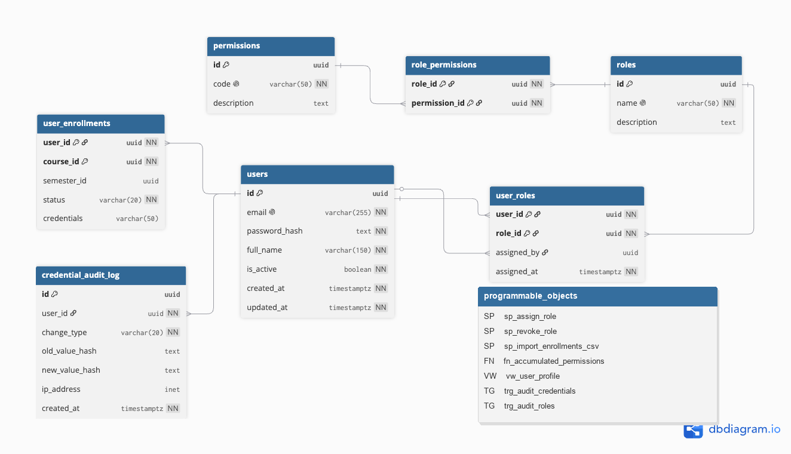](base-de-datos/img/01_der_identidad.png)

#### Catálogo

[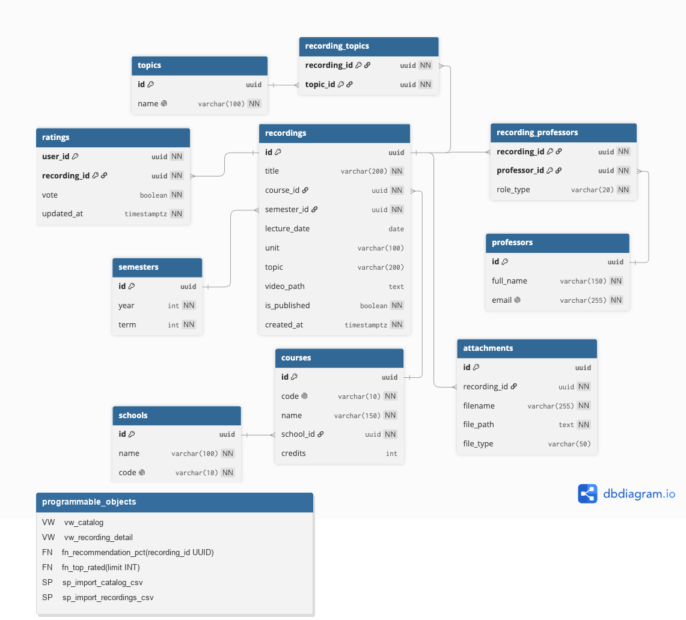](base-de-datos/img/02_der_catalogo.png)

#### Notificaciones

[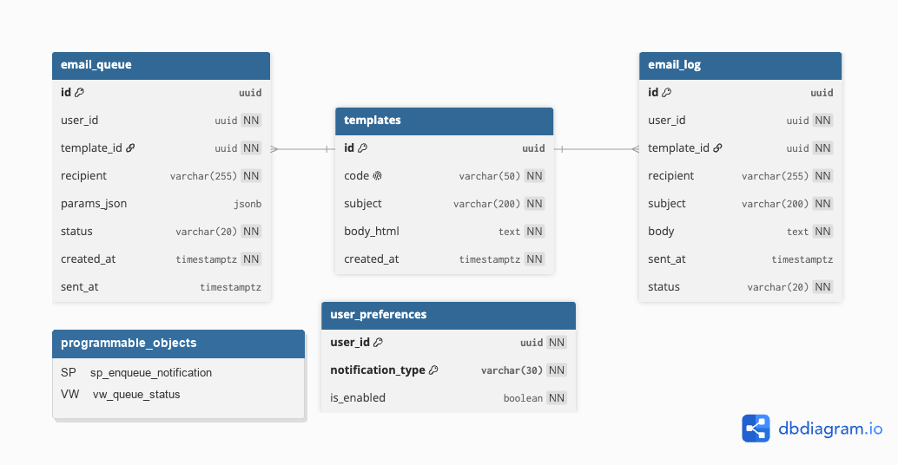](base-de-datos/img/03_der_notificaciones.png)

#### Reproducción

[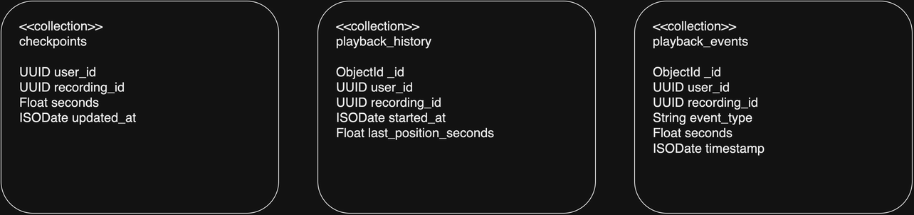](base-de-datos/img/04_colecciones_reproduccion.png)

#### Analítica

[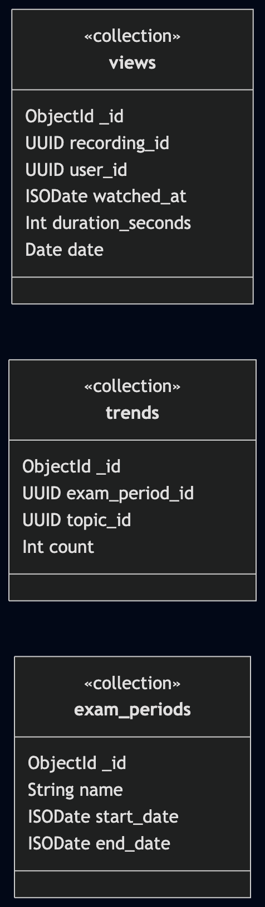](base-de-datos/img/05_colecciones_analitica.png)

### 6.2 Lógica programable

La lógica de datos se distribuye de acuerdo con el tipo de persistencia:

- **Procedimientos almacenados:** asignación y revocación de roles, importaciones CSV y encolado de notificaciones.
- **Vistas:** catálogo, ficha detallada, perfil de usuario y estado de la cola de correos.
- **Funciones:** permisos acumulados, porcentaje de recomendación y ranking de grabaciones.
- **Triggers:** auditoría de cambios de credenciales y roles.
- **MongoDB:** operaciones `upsert`, índices TTL y pipelines de agregación para reproducción y analítica.
- **Redis:** caché de catálogo, tendencias, rankings y recomendaciones con TTL definidos.

Los archivos de definición de persistencia son:

- [Identidad](base-de-datos/01-der-identidad.sql).
- [Catálogo](base-de-datos/02-der-catalogo.sql).
- [Notificaciones](base-de-datos/03-der-notificaciones.sql).
- [Colecciones de reproducción](base-de-datos/04-colecciones-reproduccion.js).
- [Colecciones de analítica](base-de-datos/05-colecciones-analitica.js).

## 7. Diseño UI/UX

Se diseñaron seis mockups de escritorio para representar los flujos principales de la plataforma. La galería y los criterios visuales están documentados en [Mockups UI/UX](mockups/README.md).

| Pantalla | Mockup |
|---|---|
| Login institucional | 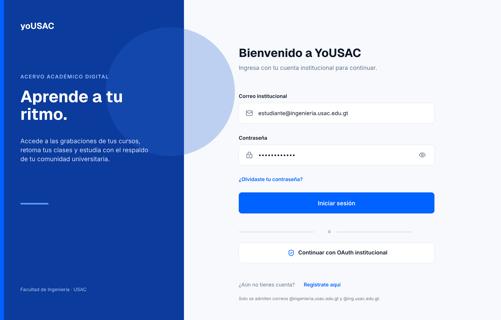 |
| Catálogo académico | 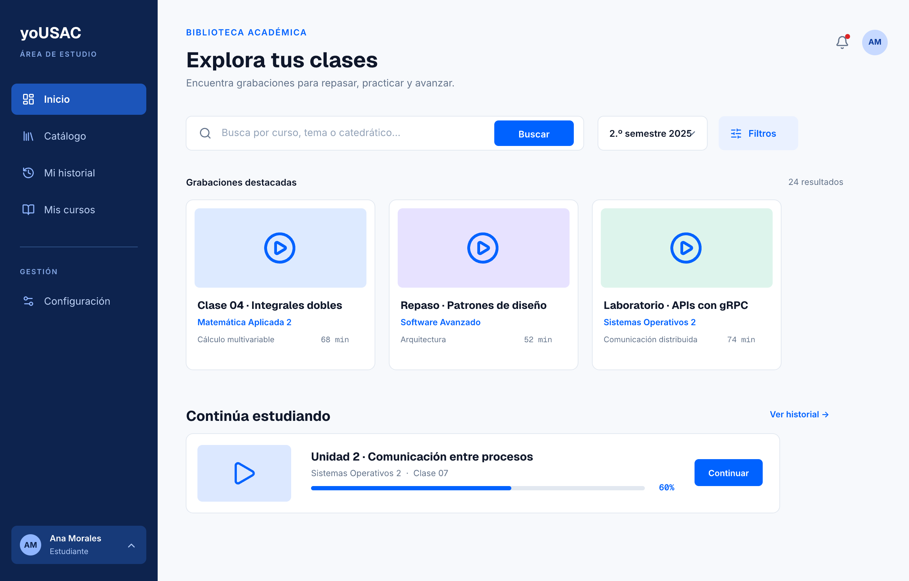 |
| Reproductor y checkpoint | 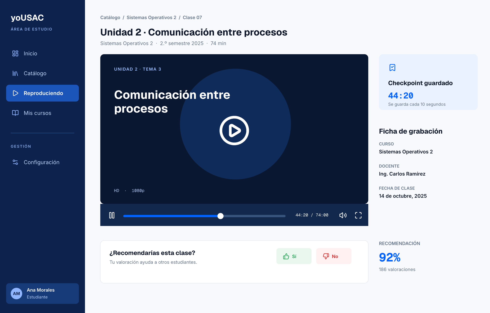 |
| Asignaciones y permisos | 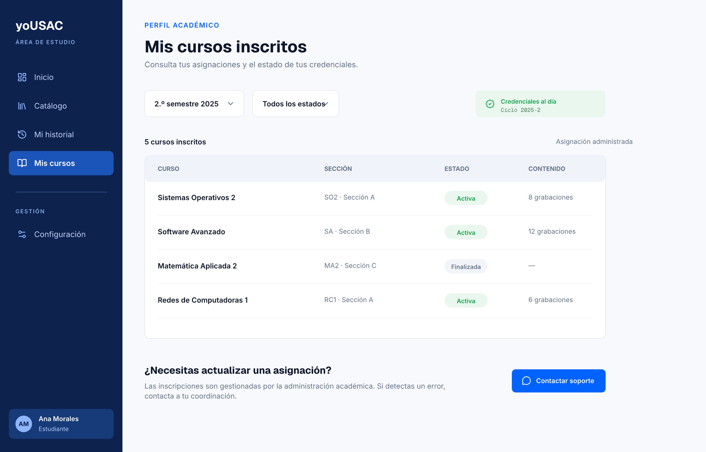 |
| Configuración de cuenta | 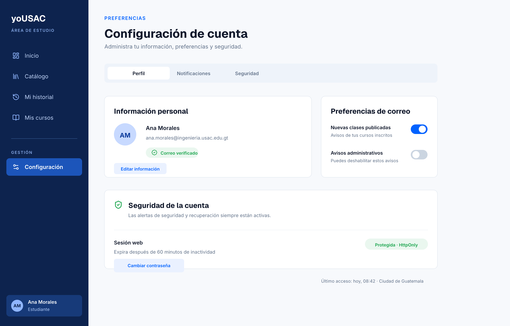 |
| Panel administrador | 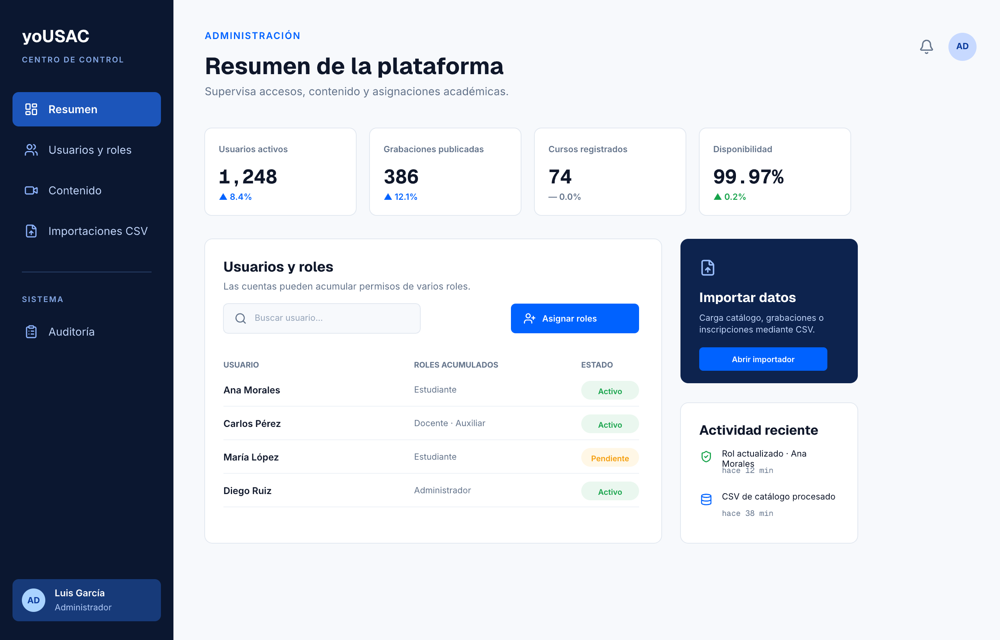 |

La propuesta visual utiliza una navegación lateral consistente, superficies claras, contraste alto y estados explícitos para progreso, checkpoint, credenciales, sesión y permisos. El flujo de inscripción se presenta como una asignación administrada por coordinación y no como autoservicio.

## 8. Archivos fuente de la documentación

Para conservar la editabilidad y permitir la validación de los diagramas, el repositorio incluye los archivos crudos junto con sus exportaciones:

- [Fuentes de casos de uso `.drawio`](casos-de-uso/referencias/casos-de-uso/).
- [Fuentes de casos de uso locales `.drawio`](casos-de-uso/referencias/casos-de-uso-locales/).
- [Fuentes de arquitectura `.drawio`](arquitectura/img/).
- [Scripts SQL y JavaScript del modelo de datos](base-de-datos/).
- [Imágenes de los DER](base-de-datos/img/).
- [Imágenes de los mockups](mockups/).

Cada diagrama editable se conserva junto a su versión exportada para consulta en GitHub.

## 9. Integración y control de versiones

El desarrollo se realizó en una rama específica para la práctica, con commits descriptivos y separación entre la rama de trabajo, `develop` y `main`.

| Elemento | Evidencia |
|---|---|
| Rama de trabajo | [`docs/practica-1`](https://github.com/AbdielOtzoy/SA_PROYECTO_202300350/tree/docs/practica-1) |
| Integración a `develop` | Pull Request de `docs/practica-1` hacia `develop`. |
| Integración a `main` | Pull Request de `develop` hacia `main`. |
| Versión de entrega | Tag `0.1.0`. |
| Repositorio | [SA_PROYECTO_202300350](https://github.com/AbdielOtzoy/SA_PROYECTO_202300350) |

Los enlaces específicos de los Pull Requests pueden agregarse a esta tabla después de crearlos. La versión final de este documento debe quedar incluida en el commit que se integre a `main` y en el tag `0.1.0`.

## 10. Conclusiones

- Se definió el alcance funcional de YoUSAC y se documentaron los requerimientos funcionales y no funcionales con prioridades y métricas verificables.
- El modelo de casos de uso cubre los módulos de autenticación, catálogo, reproducción y asignaciones, incluyendo descomposiciones y narrativas expandidas con diagramas locales.
- La arquitectura 4+1 organiza los componentes de la plataforma y establece la separación políglota entre TypeScript, Go y Python, así como la comunicación interna mediante gRPC sobre HTTP/2.
- El modelo de datos aplica `Database per Microservice`, combina PostgreSQL, MongoDB y Redis, y asigna la lógica programable al mecanismo de persistencia correspondiente.
- Los seis mockups representan los flujos principales de usuario y administrador, manteniendo una identidad visual coherente y estados relevantes para la experiencia académica.
- La práctica queda preparada para continuar con las etapas de implementación, pruebas, integración continua y despliegue sin perder la trazabilidad entre requerimientos, arquitectura, datos e interfaz.
