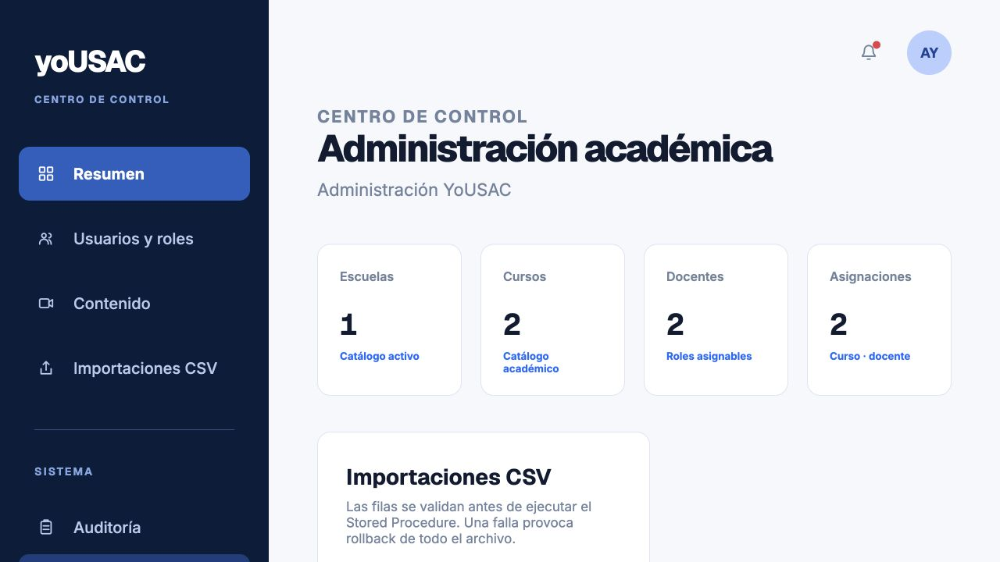

# YoUSAC — Práctica 3

## Índice

1. [Introducción](#introducción)
2. [Decisión arquitectónica](#decisión-arquitectónica)
3. [RBAC](#rbac)
4. [Contratos y flujo](#contratos-y-flujo)
5. [CSV](#csv)
6. [Stored Procedures y transacciones](#stored-procedures-y-transacciones)
7. [Paginación](#paginación)
8. [Ejecución y pruebas](#ejecución-y-pruebas)
9. [Evidencia](#evidencia)
10. [Conclusiones](#conclusiones)

## Introducción

La Práctica 3 amplía YoUSAC con un panel administrativo, gestión RBAC, asignaciones académicas, carga masiva de catálogo, paginación desde PostgreSQL y transacciones implementadas mediante Stored Procedures.

La aplicación conserva la arquitectura de las prácticas anteriores: el navegador se comunica únicamente con el API Gateway y el Gateway se comunica con los microservicios mediante gRPC sobre HTTP/2.

## Decisión arquitectónica

No se creó un microservicio nuevo. Las entidades académicas pertenecen al dominio de Catálogo y las inscripciones pertenecen al dominio de Identidad:

```text
Frontend
   │ HTTPS / REST
   ▼
Gateway
   ├── gRPC ──> Catálogo ──> catalog_db
   └── gRPC ──> Identidad ──> identity_db
```

Esta decisión mantiene las cinco responsabilidades existentes y evita que un servicio acceda directamente a la base de datos de otro servicio.

## RBAC

| Rol | Panel administrativo | Catálogos maestros | Grabaciones | Importaciones | Roles |
|---|---|---|---|---|---|
| `admin` | Sí | CRUD y archivado lógico global | Global | Catálogo, grabaciones e inscripciones | Gestiona |
| `teacher` | Sí | Consulta | Solo cursos asignados | Grabaciones de cursos asignados | No gestiona |
| `assistant` | Sí | Consulta | Solo cursos asignados | Grabaciones de cursos asignados | No gestiona |
| `student` | No | Catálogo público | No administra | No | No |

La validación se realiza en dos niveles: `SessionService` bloquea las rutas REST y cada microservicio verifica el JWT interno recibido por metadata gRPC. Ocultar botones en el frontend no es el mecanismo de seguridad.

### Perfil académico y cuenta autenticable

Un registro de `professors` en `catalog_db` representa el perfil académico de un docente o auxiliar; no crea una cuenta ni una contraseña. Las cuentas de `users` en `identity_db` son las únicas que pueden iniciar sesión y recibir roles globales. La relación entre ambos dominios se muestra mediante el correo institucional. El alcance por curso se mantiene en `course_staff` y se administra desde Configuración académica.

## Contratos y flujo

Los contratos modificados son [`proto/catalog.proto`](../proto/catalog.proto) y [`proto/identity.proto`](../proto/identity.proto).

El Gateway expone las siguientes rutas principales:

| Ruta | Operación |
|---|---|
| `GET /api/catalog` | Catálogo paginado y filtrable |
| `GET /api/catalog/options` | Opciones de filtros |
| `GET/POST/PUT/DELETE /api/admin/{schools,courses,semesters,professors}` | CRUD y archivado lógico |
| `GET/POST/DELETE /api/admin/course-staff` | Asignaciones curso–docente |
| `GET /api/admin/users` | Usuarios y roles |
| `PUT /api/admin/users/:id/roles` | Asignación o revocación de rol |
| `GET /api/enrollments` | Cursos inscritos del usuario autenticado, filtrables por semestre, estado y credenciales |
| `POST /api/admin/imports/catalog` | Importación de catálogo |
| `POST /api/admin/imports/recordings` | Importación de grabaciones |
| `POST /api/admin/imports/enrollments` | Importación de inscripciones |

El archivo se recibe como `multipart/form-data` en el campo `file`. El Gateway valida sesión, rol, extensión y tamaño; el microservicio parsea y valida filas antes de invocar el procedimiento.

El panel de cursos usa `GET /api/enrollments`. Identidad aplica los filtros sobre
`user_enrollments` y el Gateway consulta Catálogo mediante gRPC para convertir
los identificadores de curso y semestre en código, nombre, créditos y período
académico. Los estudiantes solo pueden consultar sus propias inscripciones;
los administradores pueden consultar otra cuenta mediante `user_id`.

## CSV

Todos los archivos utilizan UTF-8, encabezados obligatorios y extensión `.csv`. El tamaño máximo predeterminado es 5 MiB mediante `CSV_MAX_BYTES`.

### `catalog.csv`

```csv
school_code,school_name,course_code,course_name,credits,semester_year,semester_term
FIUSAC,Facultad de Ingeniería,SA,Software Avanzado,4,2026,2
```

### `recordings.csv`

```csv
recording_id,title,course_code,semester_year,semester_term,lecture_date,unit,topic,video_path,is_published,professor_emails,assistant_emails
10000000-0000-0000-0000-000000000001,Clase de ejemplo,SA,2026,2,2026-08-01,Unidad 1,Arquitectura,sample.mp4,true,docente@ingenieria.usac.edu.gt,auxiliar@ing.usac.edu.gt
```

Los múltiples docentes se separan con `;`. La relación curso–docente debe existir para que un catedrático o auxiliar pueda importar grabaciones de ese curso.

### `enrollments.csv`

```csv
user_email,course_id,semester_id,status,credentials
estudiante@ing.usac.edu.gt,00000000-0000-0000-0000-000000000302,00000000-0000-0000-0000-000000000303,active,regular
```

Los archivos reproducibles se encuentran en [`tests/fixtures/csv/`](../tests/fixtures/csv/).

Además de las plantillas base, se incluyen archivos para exploración manual:

- `catalog-extra.csv`: crea un área, dos cursos y el semestre 2027-1.
- `recordings-extra.csv`: agrega tres grabaciones a los cursos anteriores usando `sample6.mp4`, `sample7.mp4` y `sample8.mp4`.
- `recordings-samples.csv`: agrega siete grabaciones reproducibles para `sample6.mp4` a `sample12.mp4`.
- `enrollments-extra.csv`: agrega dos inscripciones sobre el curso demo.
- `catalog-invalid.csv`: usa un período inválido para probar validación.
- `recordings-invalid.csv`: contiene una fila válida antes de una fila con docente inexistente para comprobar rollback.

Para probar los archivos adicionales, carga primero `catalog-extra.csv` y luego `recordings-extra.csv`. Después puedes cargar `recordings-samples.csv` para registrar todos los samples nuevos.

Las rutas de video deben ser nombres de archivos presentes en [`videos/`](../videos/). El entorno local monta esa carpeta en `/videos` dentro de playback; no se deben registrar rutas `practica3-*.mp4` si esos archivos no existen.

## Stored Procedures y transacciones

Los procedimientos están definidos en:

- [`databases/catalog/03-practica3.sql`](../databases/catalog/03-practica3.sql)
- [`databases/identity/04-practica3.sql`](../databases/identity/04-practica3.sql)
- [`databases/catalog/05-practica3-video-seed.sql`](../databases/catalog/05-practica3-video-seed.sql)

| Procedimiento | Base | Uso |
|---|---|---|
| `sp_import_catalog_csv` | `catalog_db` | Escuelas, cursos y semestres |
| `sp_import_recordings_csv` | `catalog_db` | Grabaciones y docentes relacionados |
| `sp_assign_course_staff` | `catalog_db` | Asignación curso–docente |
| `sp_revoke_course_staff` | `catalog_db` | Revocación curso–docente |
| `sp_import_enrollments_csv` | `identity_db` | Inscripciones académicas |
| `set_user_role` | `identity_db` | Roles RBAC |

El backend usa `CALL ...` con parámetros JSONB. Si una fila falla, PostgreSQL aborta la llamada y no se conserva ninguna fila del archivo. Los registros repetidos se actualizan mediante `UPSERT`; las entidades y grabaciones se archivan o despublican en lugar de eliminarse físicamente.

## Paginación

`GET /api/catalog` acepta `page`, `page_size`, `q`, `school`, `course`, `semester` y `professor`.

El servicio de Catálogo limita siempre `page_size` a 10 y ejecuta la consulta sobre la vista `published_catalog` usando `LIMIT` y `OFFSET`. La respuesta incluye:

```json
{
  "recordings": [],
  "page": 1,
  "page_size": 10,
  "total": 12,
  "total_pages": 2
}
```

Los filtros se envían en cada cambio de página, por lo que no se pierden al navegar.

## Ejecución y pruebas

```bash
cp .env.example .env
./infrastructure/tls/generate-dev-cert.sh
npm ci
npm run verify
docker compose -f docker-compose.local.yml up --build
```

Para que los scripts SQL de inicialización se ejecuten desde cero, se debe utilizar un volumen nuevo de PostgreSQL. Las credenciales demo se mantienen en los seeds de Identidad y deben utilizarse únicamente en el entorno local.

### Credenciales demo locales

Todas las cuentas demo utilizan la contraseña `Practica32026`:

| Cuenta | Rol |
|---|---|
| `admin@ingenieria.usac.edu.gt` | `admin` |
| `docente@ingenieria.usac.edu.gt` | `teacher` |
| `auxiliar@ing.usac.edu.gt` | `assistant` |
| `estudiante@ing.usac.edu.gt` | `student` |

Estas credenciales no deben reutilizarse fuera de Docker local.

### Rutas del frontend

Después de iniciar sesión, la aplicación redirige según el rol:

- `admin` → `/admin`
- `teacher` → `/docente`
- `assistant` → `/auxiliar`
- `student` → `/catalogo`

El panel administrativo separa sus módulos en `/admin/contenido` (Configuración académica), `/admin/usuarios-roles`,
`/admin/importaciones`, `/admin/exportaciones` y `/admin/auditoria`.

Pruebas automatizadas relevantes:

```bash
npm test --workspace @yousac/catalog
npm run typecheck
npm run test:contracts
```

## Evidencia

Las siguientes capturas fueron tomadas contra el entorno local levantado con
`docker compose -f docker-compose.local.yml up --build`:




La verificación funcional observó:

| Escenario | Resultado observado |
|---|---|
| `GET /api/catalog?page=1&page_size=50` | HTTP 200; `page_size=10`, `total=17`, `total_pages=2` |
| Importación de catálogo, grabaciones e inscripciones | HTTP 201; 2, 12 y 1 filas aceptadas respectivamente |
| Docente en usuarios/roles | HTTP 403; importación de grabaciones de su curso asignado HTTP 201 |
| Estudiante en usuarios/roles | HTTP 403; consulta de catálogo HTTP 200 |
| `GET /api/enrollments` como estudiante | HTTP 200; devuelve cursos, semestre, estado y credenciales enriquecidos |
| `GET /api/enrollments?semester=...&status=...&credentials=...` | HTTP 200; aplica los tres filtros en Identidad |
| `GET /api/enrollments?user_id=...` como estudiante | HTTP 403; no permite consultar otra cuenta |
| Filtro por docente y navegación a página 2 | HTTP 200; filtros conservados y máximo 10 filas |

En la prueba de rollback se invocó `sp_import_recordings_csv` con una segunda
fila que referenciaba un docente inexistente: PostgreSQL produjo el error
esperado y el conteo de la grabación de prueba permaneció en `0`. Para
`sp_import_enrollments_csv`, una fila válida seguida de un usuario inexistente
produjo error y el conteo permaneció en `1`, sin conservar una inserción
parcial.

La entrega debe conservar evidencia adicional de:

1. Panel administrativo autenticado como `admin`.
2. CRUD de una escuela, curso, semestre y docente.
3. Asignación y revocación curso–docente.
4. Importación válida de los tres CSV.
5. Error de una fila y ausencia de inserción parcial.
6. Catálogo con máximo 10 registros por página.
7. Filtros combinados conservados al cambiar de página.
8. Rechazo `403` de un usuario `student` al acceder al panel.

Las consultas SQL para demostrar los procedimientos son:

```sql
SELECT routine_name
FROM information_schema.routines
WHERE routine_type = 'PROCEDURE'
  AND routine_name IN (
    'sp_import_catalog_csv',
    'sp_import_recordings_csv',
    'sp_assign_course_staff',
    'sp_revoke_course_staff',
    'sp_import_enrollments_csv',
    'set_user_role'
  );

SELECT COUNT(*) FROM recordings;
SELECT COUNT(*) FROM user_enrollments;
```

## Extensión P4 — Notificaciones

La Fase 1 extiende esta implementación con recuperación de acceso, preferencias de correo, avisos de publicación y avisos administrativos. El Gateway mantiene la exposición REST y consulta Identidad/Catálogo por gRPC; Notificaciones administra sus plantillas, preferencias, cola e historial en PostgreSQL. El detalle técnico y la evidencia de esta extensión se encuentran en [`docs/implementacion-p4.md`](implementacion-p4.md).

## Conclusiones

La implementación de la Práctica 3 conserva el aislamiento por microservicio, centraliza la exposición externa en el Gateway y utiliza los contratos gRPC existentes para agregar administración académica y el panel de cursos inscritos. Las cargas CSV son validaciones completas y transaccionales, mientras que el catálogo aplica paginación real desde PostgreSQL con un máximo de diez registros por página y filtros combinables.
